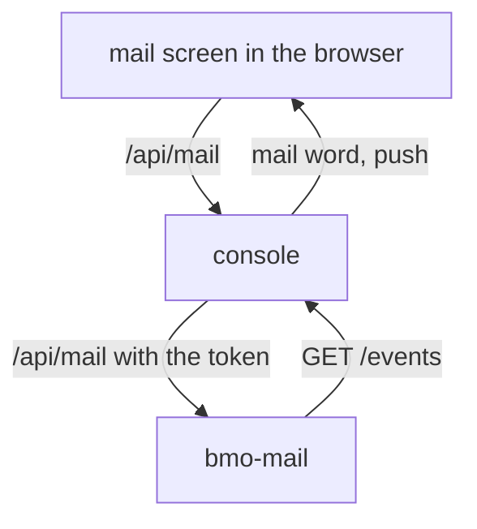

# The mail service's boundary

Every route this service answers, its event stream, its command, its store, its settings, the words it
writes, the console plugin bundle it ships and what the console in front of it does. This document is the
contract other units match: bmo-web, whose console hands the mail screen's requests on to these routes,
relays the event stream and extends the bundle; and the switch-over, which points the console at this
service. What mail does is `docs/mail.md`; this document says how it is asked. A change to anything here
changes this document in the same commit and follows the version rule (「Versions」).

## Conventions

- **Every route but `GET /health` needs `Authorization: Bearer <token>`,** the token of the settings; a
  missing or wrong token is answered 401 `unauthorized`. The console presents the token on every request it
  hands on.
- **Bodies are JSON, both ways, with field names in camelCase,** but for an upload's body, which is a
  multipart form, and the byte answers (「Byte answers」). A body that is not JSON is read as no body. A
  body, JSON or multipart, carries at most 64 MiB.
- **Times are Unix milliseconds.**
- **`{account}` in a path** is an account's key: its address's local part, matched without regard to case.
- **With no accounts file,** every route under `/api/mail/` but the avatar's answers 200 with
  `configured: false` and nothing else, and the summary with `configured: false` and no accounts; the
  watchers stand idle. Every other answer carries `configured: true` beside its own fields.
- **A refusal** is a non-2xx answer whose body carries an English sentence under `error` and a snake_case
  code under `code` (「Refusals」), and the refusal's named values beside them. The sentence is for a log; a
  screen shows the code in its own language's words.

## Who checks what

| Check | Where it stands |
|---|---|
| the console's sign-in, on every route | the console (「What the console does」) |
| the bearer token | this service |
| reachable from this machine alone | this service's settings: `server.listen` is a loopback address |

## Health

`GET /health` answers `pid`, `version` and `ready`: the store is open and migrated.

## Accounts and the summary

| Method and path | Sends | Answers |
|---|---|---|
| `GET /api/mail/accounts` | | `accounts`: each account's `address` and `key`, in the accounts file's order, nothing else of the file; `maxLabels`, the most labels an account may hold (22) |
| `GET /api/mail/summary` | | `accounts`: per account, `address`, `account` (its key), `unread` (the inbox's unread count), `newest` (the inbox's newest message, or null), `recentUnread` (the unread messages at the top of the inbox, newest first) and `failed` (its server did not answer, the counts then zero and empty) |

A summary's message is `uid`, `key` (its conversation), `from`, `subject`, `date` and `movedIn` (the
service moved it into the inbox, so it is not new mail).

## Lists and messages

| Method and path | Sends | Answers |
|---|---|---|
| `GET /api/mail/{account}/folders` | | `folders`: every folder with its `path`, `name`, `role` (`inbox`, `sent`, `drafts`, `junk`, `trash` or null), `unseen` and `total`; `labels`: the account's labels in their order |
| `GET /api/mail/{account}/list` | query `view?`, `q?`, `offset?`, `sort?` (`date`, `from`, `subject`), `dir?` (`asc` puts the least first; anything else the most), `unread?` (`1`) | a page: `total` (the messages the view holds), `offset`, and `conversations` |
| `GET /api/mail/{account}/thread` | query `key`, `folder?` (`INBOX` where none) | `messages`: every message of the conversation, oldest first, with its bodies; reading it marks nothing read |
| `GET /api/mail/{account}/message` | query `folder`, `uid` | `message`: one message with its bodies |
| `GET /api/mail/{account}/part` | query `folder`, `uid`, `part` | the part's bytes as a download (「Byte answers」) |
| `GET /api/mail/{account}/cid` | query `folder`, `uid`, `cid` | the inline image a body names by `cid:` (「Byte answers」); a part that is no image is refused `inline_image_not_found` |
| `POST /api/mail/{account}/read-all` | `view?`, `q?`, read as a list's | `marked`: how many unread messages of the whole view were marked read |

- **A view** is a folder role (`inbox`, `sent`, `drafts`, `junk`, `trash`; `inbox` where none is given),
  `starred`, `label:<id>`, `folder:<path>`, or `search` with the query in `q` (`docs/mail.md`, 「Search」).
- **Anything else in a list's query** reads as the default: a list stands rather than refusing to be read.
- **A page holds fifty messages** (`docs/mail.md`, 「Reading」).

## Changing messages

| Method and path | Sends | Answers |
|---|---|---|
| `POST /api/mail/{account}/flags` | `refs`, `add` and `remove`, each a list of flags | nothing beyond `configured` |
| `POST /api/mail/{account}/move` | `refs`, `to` (`trash`, `spam`, `not-spam` or `folder`), `folder` where `to` is `folder` | nothing beyond `configured`; `spam` sets `$Junk`, `not-spam` moves to the inbox and sets `$NotJunk` |
| `POST /api/mail/{account}/delete` | `refs`, every one in spam or trash | nothing beyond `configured` |

- **`refs`** is a list of at least one message, each `folder` and `uid`.
- **A flag** is `\Seen`, `\Flagged`, `\Answered`, `$Forwarded`, `$Junk`, `$NotJunk`, `$MDNSent`, or a label's
  keyword.

## Labels

| Method and path | Sends | Answers |
|---|---|---|
| `POST /api/mail/{account}/labels` | `name`, `color` | `label`: the new label, placed after the others |
| `PATCH /api/mail/{account}/labels/{id}` | `name?`, `color?` | nothing beyond `configured` |
| `DELETE /api/mail/{account}/labels/{id}` | | nothing beyond `configured`; its keyword is taken off every message that carried it |

A label is `id`, `name` (1 to 60 characters, one per name in an account), `color` (`#` and six hex digits,
kept in lower case) and `position`.

## Writing

| Method and path | Sends | Answers |
|---|---|---|
| `GET /api/mail/{account}/addresses` | query `q` | `addresses`: completion from the addresses the account has used and heard from |
| `POST /api/mail/{account}/draft/start` | `kind` (`new` where none, `reply`, `reply-all`, `forward`), and `folder` and `uid` of the original but for `new` | `draft`: what the composer opens with, the account's signature in it |
| `GET /api/mail/{account}/draft` | query `folder`, `uid` | `draft`: the saved draft, parsed back with its attachments |
| `POST /api/mail/{account}/draft` | a draft | `saved`: where the draft now stands, the copy it replaces deleted after |
| `DELETE /api/mail/{account}/draft` | `folder`, `uid` | nothing beyond `configured` |
| `POST /api/mail/{account}/upload` | a multipart form: `file`, one field to a file, and `attached`, the JSON list of the sizes of the attachments the message already carries | `files`: each staged file's `id`, `filename`, `type` and `size` |
| `POST /api/mail/{account}/send` | a draft | `id` (the hold's), `draft` (where the saved draft stands) and `holdMs` (10000) |
| `GET /api/mail/{account}/send/{id}` | | `state`: `holding`, `sent`, `cancelled`, or `failed` with an English `reason`; null once it has long ended |
| `DELETE /api/mail/{account}/send/{id}` | | `draft`: the draft to reopen, or null where the message has already gone |
| `POST /api/mail/{account}/receipt` | `folder`, `uid`, `send` (true sends the receipt, anything else declines it) | nothing beyond `configured` |

- **A draft** is `from` (the account's address, or left out), `to`, `cc` and `bcc` (each a list of `name`
  and `address`), `subject`, `html`, `attachments`, `receipt` (a read receipt asked), `kind` (`new`,
  `reply`, `forward`), `original`, `inReplyTo` (each a message ID in angle brackets, or null),
  `references` (message IDs) and `saved` (the draft it replaces, `folder` and `uid`, or null).
- **An attachment** of a draft is an upload, `kind` `upload` with the staged `id`, or a part of a message on
  the server, `kind` `part` with `folder`, `uid` and `part`; each with `filename`, `type` and `size`.
- **An upload is refused whole** where the message would no longer fit the size the submission server takes.

## Filters, spam senders and settings

| Method and path | Sends | Answers |
|---|---|---|
| `GET /api/mail/{account}/rules` | | `rules`: the account's rules in their order; `presets`: the ready rules for `X-Spam-Flag: YES` and `X-Bogosity: Spam` |
| `POST /api/mail/{account}/rules` | a rule draft | `rule`: the new rule, placed after the others |
| `PUT /api/mail/{account}/rules/{id}` | a rule draft | nothing beyond `configured` |
| `DELETE /api/mail/{account}/rules/{id}` | | nothing beyond `configured` |
| `POST /api/mail/{account}/rules/order` | `ids`, the rules in the order wanted | nothing beyond `configured` |
| `POST /api/mail/{account}/rules/run` | `folder?` (`INBOX` where none) | `kept` and `moved`: the messages the rules left and moved |
| `POST /api/mail/{account}/spam-senders` | `add`, a list of addresses | `spamSenders`: every always-spam sender |
| `DELETE /api/mail/{account}/spam-senders` | `address` | `spamSenders` |
| `GET /api/mail/{account}/settings` | | `signature`, `receiptDefault`, `showImages` and `spamSenders` |
| `POST /api/mail/{account}/settings` | any of `signature` (at most 200,000 characters of markup), `receiptDefault`, `showImages` | the three as they now stand |

- **A rule draft** is `enabled`, `match` (`all` or `any`), `conditions` and `actions`; a rule adds `id` and
  `position`.
- **A condition** is `field` (`from`, `to`, `subject`, `header`), `header` for a header condition, and
  `contains`, compared without regard to case.
- **An action** is `kind` `label` with `label`, `star`, `read`, `move` with `folder`, `spam` or `trash`.

## Sender avatars

| Method and path | Sends | Answers |
|---|---|---|
| `GET /api/mail/avatar` | query `domain` | the domain's logo (「Byte answers」), or 204 with no body where none was found |

It reads no account and answers with no accounts file as with one.

## What a message is

- **A list message** is `folder`, `uid`, `key` (its conversation), `messageId`, `subject`, `from` and `to`,
  `date`, `seen`, `flagged`, `answered`, `draft`, `receiptAnswered`, `labels` (label ids),
  `hasAttachments` and `snippet`.
- **A conversation** is `key`, `subject`, `date`, `from` (the senders on this page, newest first, each
  once), `count`, `unread`, `flagged`, `labels`, `hasAttachments`, `snippet` and `messages`, each
  `folder` and `uid`.
- **A message** is a list message with `cc`, `bcc`, `replyTo`, `inReplyTo`, `references`, `receiptTo`
  (where a read receipt is asked to go, or null), `text` and `html` (the decoded bodies, or null),
  `attachments` and `inline`.
- **A part** is `part` (its number in the message), `type`, `charset`, `encoding`, `filename`, `size` (the
  encoded size the server reports) and `cid` (without angle brackets, or null).

## Byte answers

| Route | Headers |
|---|---|
| `part` | `content-type` (the part's type where it is a well-formed type, else `application/octet-stream`), `content-disposition: attachment` naming the file both in ASCII and in UTF-8, `x-content-type-options: nosniff`, `content-security-policy: default-src 'none'; sandbox`, `cache-control: private, max-age=3600` |
| `cid` | the same, with `content-disposition: inline` |
| `avatar` | `content-type` (the picture's), `content-security-policy: sandbox; default-src 'none'; style-src 'unsafe-inline'`, `x-content-type-options: nosniff`, `cache-control: private, max-age=86400`; a 204 carries `cache-control: private, max-age=3600` alone |

## Refusals

| Status | Code | When | Named values |
|---|---|---|---|
| 401 | `unauthorized` | the bearer token is missing or wrong | |
| 404 | `no_such_account` | no account has the key | |
| 502 | `server_silent` | the mail server did not answer, or failed | |
| 400 | `bad_uid` | a `uid` is not a positive whole number | |
| 400 | `missing_folder` | a message names no folder, or a `folder:` view no path | |
| 400 | `missing_label` | a `label:` view names no label | |
| 400 | `bad_view` | a view is none of the kinds | |
| 400 | `nothing_picked` | `refs` is missing or empty | |
| 400 | `bad_flag` | a flag is not one that may be set | `flag` |
| 400 | `bad_move_target` | `to` is none of the kinds, or `folder` names none | |
| 400 | `delete_outside_trash` | a message to delete is not in spam or trash | |
| 400 | `message_not_found` | the message is not on the server | |
| 400 | `inline_image_not_found` | no image of the message has the `cid` | |
| 400 | `bad_label_color` | a colour is not `#` and six hex digits | |
| 400 | `bad_label_name` | a label's name is empty or longer than 60 characters | |
| 400 | `label_exists` | the account has a label of that name | |
| 400 | `label_not_found` | no label of the account has the id | |
| 400 | `too_many_labels` | the account holds the most labels it may | `n` |
| 400 | `bad_compose_mode` | `kind` is none of the kinds | |
| 400 | `sender_not_account` | a draft's `from` is not the account's address | |
| 400 | `bad_address` | an address is not one | `address` (empty where none was written) |
| 400 | `bad_attachment` | an attachment is neither kind | |
| 400 | `missing_attachment` | an attachment names no staged id or no part | |
| 400 | `upload_gone` | a staged file is no longer there | `name` |
| 400 | `no_draft_uid` | the server did not say where it put the saved draft | |
| 400 | `draft_not_found` | the draft is not on the server | |
| 400 | `no_upload` | an upload carries no file | |
| 400 | `upload_too_large` | the files would not fit the size the server takes | |
| 400 | `no_recipients` | a message to send has no recipient | |
| 400 | `message_too_large` | the encoded message is past the size the server takes | |
| 400 | `no_receipt_asked` | the message asks for no read receipt | |
| 400 | `bad_rule_match` | `match` is neither `all` nor `any` | |
| 400 | `rule_empty` | a rule has no condition or no action | |
| 400 | `bad_condition` | a condition's field is none of the kinds, or it contains nothing | |
| 400 | `header_name_needed` | a header condition names no header | |
| 400 | `bad_rule_action` | an action is none of the kinds | |
| 400 | `rule_target_needed` | a label action names no label, or a move no folder | |
| 400 | `rule_not_found` | no rule of the account has the id | |
| 400 | `signature_too_long` | the signature is past the limit | `n` |

## The event stream

`GET /events` is a stream of server-sent events, one connection for as many consumers as the console
holds. It carries no ids and replays nothing: a consumer that opens it, or opens it again, reads the summary
to learn what happened while it was closed. An idle stream carries a comment line every fifteen seconds.

| Event | Data | When |
|---|---|---|
| `mail` | `account`: the key | an account's inbox changed: mail arrived and was handled, or the server reported a flag or an expunge |
| `arrival` | `account` (the key), `address`, `messages` and `push` | new mail stayed in the inbox, unread and not from the account itself (`docs/mail.md`, 「Connections and the watcher」) |

- **An arrival's message** is `folder`, `uid`, `key`, `from`, `subject` and `date`.
- **`push`** is the notification the arrival makes: `kind` (`mail`), `title`, `body`, `path` (the newest
  message's thread, `/mail/<account>/inbox/<key>`, under the console's base path) and `tag` (`mail:<account>`,
  so a second one for the account replaces the first), written in the service's own words. It is null where
  no message came.

## The service's own words

The words the service writes into a message or a notification are its own pack: one TOML file to a
language, `wording/<language>.toml` under the settings folder, chosen by the setting `wording.language`.
The repository ships `wording/ko.toml` and builds it in, so a service whose settings folder holds no file
for its language writes the shipped words. A key holding `{name}` takes that value.

| Key | Where it is written |
|---|---|
| `locale` | the locale a date is written in, such as `ko_KR` |
| `date` | how a date is written, in `strftime` form | 
| `arrival.title_one` (`address`), `arrival.title_many` (`n`, `address`), `arrival.body` (`who`, `subject`), `arrival.no_sender`, `arrival.no_subject` | an arrival's notification |
| `reply.attribution` (`date`, `from`) | the line over a quoted reply |
| `forward.header`, `forward.from`, `forward.date`, `forward.subject`, `forward.to`, `forward.cc`, each taking the field of its name | the head of a forwarded original |
| `receipt.subject` (`subject`), `receipt.body` (`account`, `subject`) | a read receipt sent |

Dates are written by `date` in `locale` at the setting `wording.time_zone`, and counts with the
language's grouping. The same language orders names and subjects in a list (`docs/mail.md`, 「Reading」).

## The store

A SQLite file, the one `store.path` names, opened and migrated when the service starts. Every row is an
account's by its address but for a sender logo, which is a domain's.

| Table | Columns | What it holds |
|---|---|---|
| `labels` | `account`, `id`, `name`, `color`, `position`, `created_at`; key `account`, `id` | the account's labels |
| `rules` | `id` (its own), `account`, `position`, `enabled`, `match`, `conditions` and `actions` (JSON), `created_at`; indexed by `account`, `position` | the filter rules |
| `settings` | `account` (key), `signature`, `receipt_default`, `show_images` | the account's settings |
| `spam_senders` | `account`, `address`, `created_at`; key both | the always-spam senders |
| `marks` | `account`, `folder`, `uid_validity`, `last_uid`; key `account`, `folder` | the watcher's high-water mark |
| `addresses` | `account`, `address`, `name`, `last_used`, `uses`; key `account`, `address` | the known addresses |
| `avatars` | `domain` (key), `type`, `bytes` (none where nothing was found), `looked_up_at` | the sender logos |

## The command

`bmo-mail` is one binary, the service and its command alike, read by bmo-cli as a unit command (bmo-cli's
`docs/boundary.md`, 「Unit commands」).

- **`bmo-mail serve`** opens and migrates the store, starts the watchers and answers the routes.
- **`bmo-mail health`** asks the service the settings name, waiting at most five seconds, and ends 0 where
  it answers ready.
- **`bmo-mail nouns`** prints nothing: the service carries no noun of `bmo`.

## What the service reaches beside the units

It calls no other unit.

- **The IMAP and submission servers** the accounts file names, over TLS but where the file says `-`.
- **The accounts file** the setting `accounts.file` names, read again when it changed and checked every
  minute.
- **DNS and the open web** for sender logos: a domain's BIMI record, and an HTTPS address on the open web,
  never one of this machine's own networks (`docs/mail.md`, 「Sender avatars」).
- **The staging folder** the setting `staging.dir` names.

## Settings

The settings are read at start in layers, each overriding the one before: the defaults, which are the
repository's own `settings.toml` built into the binary; then `settings.toml` and `settings.local.toml` where
they stand in the settings folder, the one `BMO_MAIL_SETTINGS` names, else the folder above the one holding
the binary (a deployment's root); then `BMO_MAIL_<TABLE>__<KEY>` in the environment. A relative path is read
from the settings folder. An empty token lets no caller in.

| Table | Key | What it is | Default |
|---|---|---|---|
| `server` | `listen` | where the service answers, as `host:port` | `127.0.0.1:3330` |
| `server` | `token` | the bearer token every caller presents | none |
| `store` | `path` | the SQLite file of 「The store」 | `mail.db` |
| `accounts` | `file` | the accounts file (`docs/mail.md`, 「Accounts and credentials」); a deployment names the data root's `env/mail-accounts` | none: no accounts |
| `staging` | `dir` | the folder uploads wait in | `mail-staging` |
| `wording` | `language` | the language of 「The service's own words」 and of a list's order | `ko` |
| `wording` | `time_zone` | the time zone dates are written in | `Asia/Seoul` |

## The console plugin bundle

`bmo-mail-client`, in `client/`: the mail screen as a Nuxt layer the console extends, mounted at `/mail`
with every address below it (`docs/mail.md`, 「The screen」).

- **What its host serves it:** the bmo-ui layer, and the routes above under `/api/mail/`, handed on to
  this service with its token behind the console's sign-in.
- **How a host takes it:** the bundle is packed from `client/` with `bun pm pack` into
  `bmo-mail-client-<version>.tgz`, carrying its manifest, its Nuxt configuration, `app/`, `shared/` and its
  language pack under `i18n/`. A host keeps the packed bundle in its own tree and depends on it by that
  file, depends on bmo-ui at the version the bundle's peer names, and names `bmo-mail-client` in its Nuxt
  configuration's `extends`, which brings bmo-ui's layer with it.
- **What it depends on beside bmo-ui:** bmo-markup's `web-address`, for the links a plain-text body shows,
  and the TipTap editor packages its editor is built on. For the bundle's own install and typecheck a packed
  copy of bmo-ui stands in `client/vendor/`, and bmo-markup's TypeScript package is read from the base
  library's own folder.
- **What its host owes it,** declared in `client/host/` for the bundle's own typecheck alone:
  - `useMailEvents(onChange)`, made importable by name as Nuxt makes a project's own composables: calls
    `onChange` with the account key of each `mail` event relayed into the tab, and with null each time the
    tab's stream opens;
  - its layout calling the bundle's `useMailNotices(t)` once, which raises the arrival notices and answers
    `unread`, the mark the host's `/mail` navigation entry carries while any inbox holds unread mail;
  - the components `DeployMark`, `TodoOpenButton` and `UsageMeters` of the console's title bar, registered by
    name and handed no props;
  - its i18n module, which merges the bundle's own pack into the host's locale of the same code.
- **Wording:** every word the screen shows is the bundle's language pack, `client/i18n/locales/ko.yaml`,
  registered by code (`ko`), language tag (`ko-KR`) and file, as the host registers its own locales. It
  holds the 292 keys under `mail`, `screens.label.mail`, `screens.aria.mail_unread` and the 17 `common` keys
  the screen reads; where the host's pack holds a key too, the host's value stands. The screen shows a
  refusal by the key `mail.error.<code>`, its named values filled in.

## What the console does

These are bmo-web's to carry; this repository holds none of them.

- **Hand on** every request under `/api/mail/` whole — the method, the query, the body and the headers that
  say what is asked — to the address `MAIL_ADDRESS` names with the token `MAIL_TOKEN` names, and hand the
  answer back as it came, a byte answer as its bytes and headers, behind the console's sign-in.
- **Relay the event stream:** hold `GET /events` open, and write each `mail` event into every tab's event
  stream as the mail word, whole and between two whole events of its own, carrying no cursor.
- **Ring the push:** for each `arrival` whose `push` is not null, ring it to every device that receives
  the `mail` kind, as one console rings, the path taken under the console's base path.
- **Extend the console plugin bundle** under `client/` in place of the `/mail` placeholder, and owe the
  host's parts the bundle declares (「The console plugin bundle」).

## Missing in siblings

What another repository's own boundary must gain for this one to stand on it, each for that repository's
worker:

- **bmo-web:**
  - `MAIL_ADDRESS` and `MAIL_TOKEN` among its settings, and the handing on of `/api/mail/`, which its
    boundary states for no route of this unit yet;
  - the relay of this service's `GET /events` into the tabs' stream, and `useMailEvents` for the bundle;
  - browser push: its boundary states no push route, no notification kinds and no devices, so nothing here
    can be rung until it does; the `mail` kind's declaration — on for a new device — and the two words its
    notification settings show for it are bmo-web's to hold beside the kinds of its own;
  - the bundle in place of the `/mail` placeholder, and its `docs/language-pack.md` naming the bundle's
    pack, merged as a layer's locale under the console's.

## Versions

The repository's version is the crate's, in semver. The major moves on a change to this document's routes,
events, fields, codes, words' keys, command or settings that a caller must follow; the minor on an addition to
any of them; the patch on a change that leaves every statement here true.
