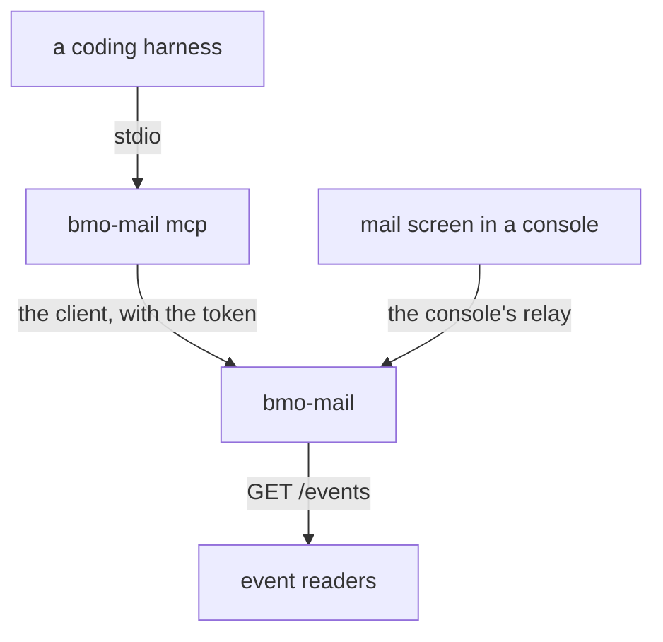

# The mail service's boundary

Fixed at the release the commit is tagged with.

Every route this service answers, its event stream, its command, its client, its harness plugin, its hosted
tool, its store, its settings, the words it writes and the console plugin bundle it serves. The service is an upstream: a coding
harness takes it as its first entry point through its MCP server, and a console takes its screen through the
bundle its manifest names. It follows the common wire format and the API design of bmo-chat's `docs/conventions.md`, and states
here only what is its own. What mail does is `docs/mail.md`; this document says how it is asked.

## The contract

- **`docs/openapi.json` is the contract,** the OpenAPI 3.1 document the service writes from its own types:
  every route with its parameters, its body, its answers and the codes it can answer, the bodies' schemas,
  the events under `x-events`, the harness plugin under `x-harness` and its tools under `x-tools`. Each route
  states its own part of it beside its answer. `cargo run --example openapi` prints the document as the
  repository keeps it.
- **Every route, `GET /health` among them, needs `Authorization: Bearer <token>`:** the service's token,
  `server.token`, on every route, or the console's credential, `console.token`, on the routes the screen uses
  alone. A missing or wrong token is answered 401 `unauthorized`, and an empty one lets no caller in. The
  console face's own routes take the console's credential alone (「The console plugin bundle」).
- **Every route the screen uses needs `Owner-Role` and `Owner-Key`,** the headers bmo-ui's console plugin
  contract names (「Who checks what」): every route here but `GET /health`. `Owner-Role` is the role the reader
  holds, `administrator` or `member`, and either allows the screen's role, `member`; `Owner-Key` is the opaque
  key of the owner the caller acts for. A call whose role is missing or not one of the two, or whose owner key is
  missing or empty, is refused 403 `forbidden`; an owner key past 200 characters is refused 400 `bad-request`.
  The routes that read no account, `GET /account-kinds` and `GET /avatars/{address}`, take the headers and act
  for no owner. The system mail's routes take neither header and a credential of their own (「System mail」).
- **Bodies are JSON with camelCase keys, both ways,** but for the byte answers (「Byte answers」). A body
  carries at most 64 MiB. A body or a query that is not the shape the route takes is refused 400
  `bad-request`, the sentence naming what is wrong.
- **Times are integers of epoch milliseconds,** spans end in `Ms` and counts in `Count`.
- **A list is a page,** `{"items": [...], "more": boolean}`.
- **No path carries a prefix.** A console that serves the routes to a browser mounts them under a prefix of
  its own and passes the path on unchanged.

## Who checks what

- **The console checks the person.** It signs the person in, decides which owner key stands for their login
  account and which role they hold, and sets `Owner-Key` and `Owner-Role` on every request it hands on to the
  service, replacing any the browser sent, so a browser never chooses its own key or role. The service never
  reads the console's login accounts.
- **The service checks its bearer token, and that the role and the owner key are given.** It takes both as the
  console's word, the bearer token being what makes them the console's: the role compared against the screen's,
  the owner key an opaque string of 1 to 200 characters, compared exactly, never parsed and never answered. Every account stands under
  the key that added it, and a key reaches only its own: another owner's account is answered as if it did not
  stand. A caller holding a token may act for any key, so the service's token is the harness's alone and the
  console's credential the console's alone.
- **The administrator's key** is the setting `accounts.administrator`. The accounts imported from the accounts
  file are that key's (`docs/mail.md`, 「The accounts file, imported once」), and the harness plugin acts for
  it unless it is told another (「The harness plugin」). The key is an owner key like any other; no route turns
  on it, and no route needs more than the screen's role.
- **The account service's system sends** present the credential the setting `system_mail.token` names, which
  reaches the system mail's routes and nothing else (「System mail」); the service's token reaches them as well.
- **The service listens on a loopback address,** so only this machine reaches it.

## Keys

| Key | What it is |
|---|---|
| `{accountName}` | An account's name, unique among its owner's accounts and matched without regard to case: its address's local part unless it was given another. |
| `{authorizationId}` | An authorization's id: opaque, given when the authorization is started. |
| `{folderName}` | A folder's full name on the server, its hierarchy delimiter and all, percent-encoded in the path. |
| `{messageId}` | A message's id: opaque, naming its folder and its UID there, which on a POP3 account is the number the service gave it (`docs/mail.md`, 「A POP3 account」). It stands as long as the message stays in that folder; a move gives the message a new one. |
| `{threadId}` | A conversation's id: opaque, the same for every message of the conversation whatever its folder. |
| `{partId}` | A part of a message: its number in the message (`1.2`), or its content id without angle brackets. |
| `{draftId}` | A draft's id: the `Message-ID` it is saved under, without angle brackets. It stands across every save. |
| `{sendId}` | A send's id: opaque, given when the send is made. |
| `{labelId}` | A label's id, given when the label is made. |
| `{ruleId}` | A rule's id, a signed 64-bit integer. |
| `{address}` | A mail address. |
| `{serverId}` | A mail server's id, a signed 64-bit integer given when the server is kept. |

A key that names nothing is answered 404 `not-found`, an account's name naming no account among them.

## Health

`GET /health` answers `ready` (the store is open and migrated), `reason` (null while ready) and `version`.

## Accounts

Every route here but the kinds acts for the owner key the request carries, and reaches that owner's accounts
alone (「Who checks what」).

| Method and path | Sends | Answers |
|---|---|---|
| `GET /account-kinds` | | a page of the kinds the service declares, one for each adapter built into it |
| `GET /accounts` | query `after?`, `limit?` | a page of the owner's accounts, in their order |
| `POST /accounts` | `kind?`, `name?`, `address?`, `incomingServer?`, `outgoingServer?`, `settings?`, `secrets?`, `authorization?` | 201, the account, once it signed in |
| `GET /accounts/{accountName}` | | the account |
| `PATCH /accounts/{accountName}` | any of `name`, `position`, `address`, `incomingServer`, `outgoingServer`, `settings`, `secrets` | the account |
| `DELETE /accounts/{accountName}` | | 204; the account is forgotten with everything the store holds for it |
| `POST /authorizations` | `kind`, `returnTo` | 201, the authorization: the provider's page to send the browser to |
| `GET /summary` | | `accounts`, every account of the owner, and `unreadCount`, the unread messages of every reachable inbox together |

- **A kind** is `name` (its adapter's name, which an account names it by), `signIn` (`password`: an account is
  added from its fields; `authorization`: through the provider's own page), `moves` (its mailbox moves mail
  between folders: a move, spam and not spam, trash and deleting for good; the screen draws none of them for an
  account whose kind does not, `docs/mail.md`, 「The screen」), `servers` (for a kind reached through mail
  servers, `incoming`, the protocol of the incoming server it reads, and `outgoing`, of the outgoing server it
  sends through; null for a kind that names none) and `fields`, what a person writes to
  add an account of it, in the order a form shows them. A field is `name` (the key it stands under in an
  account's `settings` or `secrets`), `kind` (`text`, `port`, or `secret`: kept encrypted and never answered),
  `required` and `default` (the value a form starts from, or null). The address and the name are every
  account's, and no kind declares them as fields.
- **The kinds** each adapter declares:

  | Kind | Signs in by | Moves | Servers | Fields |
  |---|---|---|---|---|
  | `imap-smtp` | password | yes | `imap`, `smtp` | `login`, `password` (secret) |
  | `pop3-smtp` | password | no | `pop3`, `smtp` | `login`, `password` (secret) |
  | `gmail` | authorization | yes | none | none: the Gmail API adapter keeps the tokens Google hands back as the account's secrets |
  | `graph` | authorization | yes | none | none: the Microsoft Graph adapter keeps the tokens Microsoft hands back as the account's secrets |

  A kind is declared, listed and taken only where its adapter is built into the service. `imap-smtp` and
  `pop3-smtp` are; `gmail` and `graph` stand here as their contract, and until their adapters are built a
  request naming either is refused 422 `unknown-kind`. For `imap-smtp` and `pop3-smtp` a login left empty is
  the address. Which protocol reaches an account's inbox is its kind, so an account added as one kind stays that
  kind; a change of its incoming server changes its server within it.
- **An account** is `name` (1 to 64 characters with no slash or space, kept in lower case), `kind`, `address`,
  `position` (its place in its owner's list, from 1), `settings` (its fields that are not secret, by name, each
  a string), `incomingServer` and `outgoingServer` (the servers' ids, null for a kind that names none),
  `unreadCount` (its inbox's unread messages) and `reachable` (its server answered; where it did not, the count
  is 0). Its secrets are never answered.
- **Adding an account by password:** `address` (required), `incomingServer` and `outgoingServer` (required for a
  kind that names servers: ids of servers the owner reaches, 「Servers」; one the owner does not reach is refused
  422 `unknown-server`, and an incoming server of another protocol than the kind's, or an outgoing server that is
  no `smtp`, 422 `server-mismatch`), `kind` (where none is given, the kind whose `servers.incoming` is the
  incoming server's protocol), `settings` and `secrets` (by field name, each a string; a required field missing,
  or a field the kind does not declare there, is refused 400 `bad-request`) and `name` (the address's local
  part where none is given). A name taken among the owner's accounts is refused 409 `conflict`. The service then signs in, and an account whose servers did not take its login is
  refused 422 `sign-in-failed` with nothing of it kept. A service with no key file refuses 503 `not-ready`
  (`docs/mail.md`, 「Accounts and credentials」). The account is placed after the owner's others.
- **Adding an account by authorization** is two steps. `POST /authorizations` names the `kind` and
  `returnTo`, the address the provider sends the browser back to, and answers `id`, `kind`, `url` (the
  provider's page to send the browser to) and `expiresAt`; the service holds it for ten minutes, for that owner
  alone. The browser comes back to `returnTo` with the provider's answer in its query, and `POST /accounts`
  with `kind`, `name?` and `authorization`, `{"id", "answer"}`, `answer` that query as an object of strings,
  finishes it: the adapter takes the tokens, reads the account's address from the provider and the account is
  kept. An authorization that is not the owner's, has run out or was used is refused 422
  `unknown-authorization`; `POST /authorizations` for a kind that signs in by password is refused 422
  `no-authorization`.
- **A change of an account:** `name` renames it (409 `conflict` where the owner holds that name); `position`
  moves it among the owner's others; `address` and `settings` replace its own, `settings` whole; `secrets`
  replaces the secrets it names and keeps the others; `incomingServer` and `outgoingServer` choose other servers
  the owner reaches, refused as adding refuses them, an incoming server of another protocol than the account's
  kind among them. A change of the address, the settings, the secrets or a server signs in again before anything
  is kept, refused 422 `sign-in-failed` where it fails. A server the account stood on before needs no reaching
  to stay.
- **An account removed** is forgotten with its labels, rules, settings, spam senders, mark, known addresses
  and a POP3 account's messages and drafts; its sends still waiting are taken back, and its mailbox on the
  server is untouched.
- **The small lists** — accounts, folders, labels, rules and addresses — are paged by `position`: `after`
  names the position of the last item read, `limit` caps the page, and with neither the whole list comes in
  one page.
- **An owner with no account** has an empty accounts page and a summary that counts nothing, and every route
  under an account answers 404.

## Servers

The mail servers accounts are reached through (`docs/mail.md`, 「Mail servers」). Every route here acts for the
owner key the request carries, as a person of the account service's: the delegation chain is asked for that
person, and a link's servers are written in their name.

| Method and path | Sends | Answers |
|---|---|---|
| `GET /servers` | query `direction?`, `link?` | a page of servers: without `link`, every server the owner reaches, their organisation's first, then the platform's, then their own; with `link`, the servers that link holds |
| `POST /servers` | `link?`, `protocol`, `name?`, `host`, `port?`, `security?`, `tlsName?`, `auth?` | 201, the server |
| `GET /servers/{serverId}` | | the server |
| `PATCH /servers/{serverId}` | any of `name`, `host`, `port`, `security`, `tlsName`, `auth` | the server |
| `DELETE /servers/{serverId}` | | 204 |
| `POST /server-tests` | `serverId?`, or the server's own fields `protocol`, `host`, `port?`, `security?`, `tlsName?`; `login?`, `password?` | `reached`, `signedIn` (null where no login and password were given) and `failure`, the code of what failed (`unreachable` or `sign-in-failed`) or null |

- **A server** is `id`, `protocol` (`imap`, `pop3` or `smtp`), `direction` (`incoming` for `imap` and `pop3`,
  `outgoing` for `smtp`), `name` (1 to 80 characters, the host where none is given), `host`, `port` (1 to 65535,
  the protocol's usual port for its security where none is given), `security` (`tls`, `starttls` or `none`;
  `tls` for an incoming server and `starttls` for an outgoing one where none is given, and a POP3 server takes no
  `starttls`), `tlsName` (the name its certificate is checked against, null for the host), `auth` (`password`, or
  `none` for an outgoing server that takes mail without a sign-in; `password` where none is given), `holder`
  (`link`: `own` for the owner's own, `platform`, or `unit:<id>`; `name`: the company's or unit's name in the
  servers an owner reaches, null for the others and in a link's own list), `mayChange` (whether the owner may change and remove it now) and `accountCount` (how many accounts
  stand on it, every owner's together). A field out of its shape is refused 400 `bad-request`.
- **`direction`** narrows a page to the incoming or the outgoing servers; **`link`** names a link of the chain,
  `platform` or `unit:<id>`, whose servers are read by whoever may read that link's entry on the chain, 403
  `forbidden` for anyone else.
- **Who holds a new server** is `link`: none for the owner's own, or a link the owner may write on the chain.
  Adding, changing and removing a server of a link writes the link's value on the chain first, in the owner's
  name, as the unit that declared the kind: a refusal there is this route's — 403 `forbidden` to anyone but the
  link's writers, 409 `locked` under a lock above, 404 `not-found` for a unit that does not stand — and nothing
  of the server changes. A server of another owner, and a server of a link the owner may not read, is answered
  404 `not-found`.
- **The protocol stays:** a change names no `protocol`, and a server of another protocol is another server.
- **A removal** of a server an account stands on is refused 409 `server-in-use`.
- **A connection test** tests a server kept, one the owner reaches or whose link they may read, or the fields a
  form holds before it is kept, and keeps nothing of either. Where a `login` and a `password` are given it signs
  in as them; `failure` is `unreachable` where no connection, security or greeting stood, and `sign-in-failed`
  where the server would not take the sign-in.
- **The delegation chain's kind** is `mail.servers`, declared as the service stands and again where the account
  service answers it undeclared: `json`, `layered`, at the platform and units, a unit's link written by its heads,
  no rules. A link's value is the list of the ids of the servers it holds.
- **Where the settings name no account service,** a page holds the owner's own servers alone, and a server of a
  link is refused 503 `not-ready`. Where the account service is named and does not answer, a route that needs it
  is refused 502 `upstream-failed`.

## Removing an owner

The platform administrator deleting an account or an organisation unit for good takes what the service keeps of
it (`docs/mail.md`, 「Accounts and credentials」 and 「Mail servers」). These routes take the service's token, or the
console's credential with `Owner-Role` `administrator`; the console's credential with any other role is refused 403
`forbidden`, and they read no `Owner-Key`. An owner or a unit is its key as the account service names it, positive
decimal digits; any other is refused 400 `bad-request`. The owner's routes stand under `/owners`, since
`/accounts/{accountName}` names a mail account.

| Method and path | Sends | Answers |
|---|---|---|
| `GET /owners/{owner}/removal` | | `counts`: what the removal below would take now, changing nothing |
| `DELETE /owners/{owner}` | | `removed`: what it took |
| `GET /org-units/{unit}/removal` | query `company?`, not read | `counts`: what the removal below would take now |
| `DELETE /org-units/{unit}` | query `company?`, not read | `removed`: what it took |

- **An owner's removal** forgets every account the owner key holds, each as `DELETE /accounts/{accountName}`
  forgets one (its sends cancelled, its mailbox closed, `account.deleted` published), and the owner's own servers;
  the event window's rows of the owner go with them. Its kinds are `accounts` and `servers`.
- **A unit's removal** forgets the servers the unit's link holds that no account stands on any more; a server an
  account still stands on is kept and counted, so nobody's account loses its server. Its kinds are `servers` and
  `servers-in-use`. The link's value on the delegation chain is the account service's, which removes the unit's
  links with the unit.
- **Each kind is always answered,** zero where nothing stands, and a second removal takes nothing, so a removal
  broken half-way is finished by calling again.

## System mail

The account service's sends of the platform's own mail (`docs/mail.md`, 「The platform's system mail」). These
routes take the credential `system_mail.token` names, or the service's token, and no owner headers; any other
bearer is refused 401 `unauthorized`, and where the setting names none, only the service's token reaches them.

| Method and path | Sends | Answers |
|---|---|---|
| `GET /outgoing-servers` | | `items`: the platform's outgoing servers, each `id`, `name`, `host`, `port`, `security` and `auth` |
| `POST /system-mails` | `server`, `from`, `fromName?`, `secret?`, `to`, `subject`, `text`, `html?`, `kind` | 201, `sent` true and `messageId`, the `Message-ID` it went under |

- **`server`** is the id of one of the platform's outgoing servers, held by the chain's `platform` link. Any other —
  a company's or a unit's, a person's own, or an incoming one — is refused 422 `unknown-server`, so the system mail
  never goes through a server the platform administrator did not set.
- **`from`** is the sender's address and `fromName` the name shown with it; **`to`** is one address. An address
  that is not one is refused 400 `bad-request`.
- **`secret`** names a secret of the platform's space, the folder `system_mail.secrets_dir` names: a file name of
  letters, digits, `.`, `_` and `-`, holding `USERNAME` and `PASSWORD` lines. The server is signed in with them; a
  secret that is not a file there, or holds no `PASSWORD`, is refused 422 `unknown-secret` without its contents
  being said. A login left out of it is `from`. A send with no secret goes through a server whose `auth` is
  `none` alone, any other refused 422 `unknown-secret`.
- **`subject`** is one line; **`text`** is the plain body and **`html`** the HTML one, the message going as both
  where both are given. **`kind`** is a kebab-case word saying what the mail is — `test`, `email-verification`,
  `password-reset` and their kin — which the log keeps beside the server's id.
- **The mail goes at once** over submission, and the answer waits for the server: a server that refuses the
  sign-in is 422 `sign-in-failed`, and one that does not answer or refuses the mail 502 `upstream-failed`, its
  sentence the server's. Nothing of a send is kept.

## Folders

| Method and path | Sends | Answers |
|---|---|---|
| `GET /accounts/{accountName}/folders` | query `after?`, `limit?` | a page of the account's folders |
| `PATCH /accounts/{accountName}/folders/{folderName}` | `read`: true marks every message of the folder read, false every one unread | the folder |

A POP3 account has two folders, its inbox, `INBOX`, and its drafts, `Drafts`, the service's own (`docs/mail.md`,
「A POP3 account」), their counts read from the store.

**A folder** is `accountName`, `name` (its full name, the key), `shortName` (the last step of the name, as a
folder with no role is shown), `role` (`inbox`, `sent`, `drafts`, `junk`, `trash`, or null), `position`,
`unreadCount` and `totalCount`.

## Messages and threads

| Method and path | Sends | Answers |
|---|---|---|
| `GET /accounts/{accountName}/messages` | query `folderName?`, `q?`, `labelId?`, `before?`, `after?`, `limit?` | a page of messages, newest first |
| `GET /accounts/{accountName}/messages/{messageId}` | | the message with its bodies |
| `PATCH /accounts/{accountName}/messages/{messageId}` | `flags`, `labelIds`, `folderName?` | the message as it now stands |
| `DELETE /accounts/{accountName}/messages/{messageId}` | | 204; only a message in spam or trash is deleted |
| `GET /accounts/{accountName}/messages/{messageId}/parts/{partId}/content` | | the part's bytes (「Byte answers」) |
| `GET /accounts/{accountName}/threads/{threadId}` | query `folderName?` | the thread with every message's bodies |

- **What a page reads:** `folderName` alone reads that folder; `labelId` the label's messages across the
  usual folders, or in `folderName` where it is given; `q` the search box's words (`docs/mail.md`,
  「Search」), across the usual folders or the one its `in:` names, or in `folderName` where it is given.
  With none of the three a page reads the inbox. A label the account does not hold is answered 404.
- **The cursor is a message's `at`.** `before` reads the messages older than it, `after` those newer, newest
  first either way; `after` answers the oldest of them, so a reader that polls with the newest `at` it holds
  misses none. A page never ends inside a run of messages of the same `at`, so the next cursor is exact.
  `limit` is 1 to 100, 50 where none is given.
- **A page leaves the bodies out:** each message of a page has `text` and `html` null, and a message read
  alone or in its thread carries them. `parts` says whether a message has a body of each kind either way.
- **A change of a message** names the whole of what it should carry: `flags`, the flags it should hold among
  those a request may set, and `labelIds`, every label it should carry. What it carries beyond that is taken
  off, what it lacks is set, and a flag no request may set is left as it is. `folderName`, where it names
  another folder, then moves the message there, and the answer is the message under its new id. A server
  that does not say where a moved message landed has it found by its `Message-ID`; where nothing finds it,
  the answer is 204.
- **The flags a request may set** are `\Seen`, `\Flagged`, `\Answered`, `$Forwarded`, `$Junk`, `$NotJunk` and
  `$MDNSent`. A flag outside them is refused 422 `flag-not-settable` unless the message already carries it.
- **On a POP3 account** the flags and labels are the service's own, kept on the message's or the draft's row
  in the store. A change whose `folderName` names a folder other than the message's own is refused 422
  `not-offered`, since mail there never moves, and a delete 422 `outside-trash`, since it has no spam or trash
  folder. A search reads the heads the store keeps (`docs/mail.md`, 「A POP3 account」).
- **A thread** gathers every message of the conversation from the inbox, the sent folders and `folderName`
  where it is given, oldest first, a message found in two folders once. Reading it marks nothing read.

### What a message is

- **A message** is `id`, `accountName`, `threadId`, `folderName`, `internetMessageId` (its `Message-ID`
  without angle brackets, or null), `inReplyTo` and `references` (message IDs the same way), `subject`, `from`
  (a mailbox, or null), `to`, `cc`, `bcc` and `replyTo` (lists of mailboxes), `at` (when it reached its
  folder, else its date), `flags` (every flag it carries but the labels' keywords), `labelIds`, `receiptTo`
  (where a read receipt is asked to go, or null), `snippet`, `text` and `html` (the decoded bodies, or null)
  and `parts`.
- **A mailbox** is `name` (or null) and `address`.
- **A part** is `partId`, `kind` (`text` or `html` for a body, `attachment`, or `inline` for a picture an HTML
  body shows by its content id), `mediaType`, `charset`, `encoding` and `fileName` (each null where the part
  names none), `size` (the encoded size the server reports) and `contentId` (without angle brackets, or null).

## Labels

| Method and path | Sends | Answers |
|---|---|---|
| `GET /accounts/{accountName}/labels` | query `after?`, `limit?` | a page of the account's labels in their order |
| `POST /accounts/{accountName}/labels` | `name`, `colour` | 201, the new label, placed after the others |
| `PATCH /accounts/{accountName}/labels/{labelId}` | `name?`, `colour?`, `position?` | the label |
| `DELETE /accounts/{accountName}/labels/{labelId}` | | 204; its keyword is taken off every message that carried it |

A label is `id`, `name` (1 to 60 characters, one per name in an account; a name taken is refused 409
`conflict`), `colour` (`#` and six hex digits, kept in lower case) and `position`. An account holds at most 22
labels; one more is refused 422 `too-many-labels`.

## Writing

| Method and path | Sends | Answers |
|---|---|---|
| `GET /accounts/{accountName}/addresses` | query `q?`, `after?`, `limit?` | a page of the addresses written to or heard from, most used first |
| `POST /accounts/{accountName}/drafts` | `replyTo?`, `replyAll?`, `forward?` | 201, the draft, saved in the drafts folder |
| `GET /accounts/{accountName}/drafts/{draftId}` | | the draft |
| `PATCH /accounts/{accountName}/drafts/{draftId}` | any of `to`, `cc`, `bcc`, `subject`, `body`, `attachments`, `receiptRequested` | the draft, saved again |
| `DELETE /accounts/{accountName}/drafts/{draftId}` | | 204 |
| `POST /accounts/{accountName}/drafts/{draftId}/attachments` | `name`, `mediaType`, `content` (the bytes in base64) | 201, the draft with the file attached, saved again |
| `POST /accounts/{accountName}/sends` | `draftId`, `sendAt?` | 201, the send |
| `GET /accounts/{accountName}/sends/{sendId}` | | the send |
| `DELETE /accounts/{accountName}/sends/{sendId}` | | 204: the send is taken back and its draft stays |
| `POST /accounts/{accountName}/receipts` | `messageId` | 201, `messageId` and `sent` |

- **An address** is `address`, `name` (or null), `usedCount`, `lastUsedAt` and `position`; `q` matches it
  against the address and the name.
- **A draft is made by its start:** `replyTo` names the message it answers, with `replyAll` true to answer
  every recipient, and `forward` the message it carries; with neither it is a new message. It is saved in the
  drafts folder at once, the account's signature in it.
- **A draft** is `id`, `accountName`, `kind` (`new`, `reply` or `forward`), `from` (the account's mailbox),
  `to`, `cc` and `bcc` (lists of mailboxes), `subject`, `body` (the HTML it is written in), `attachments`,
  `receiptRequested` (a read receipt is asked), `inReplyTo`, `references`, `originalId` (the message ID of the
  message it answers or carries, or null) and `changedAt`.
- **A draft's attachment** is `partId` (its part in the saved draft), `name`, `mediaType` and `size`. A change
  of `attachments` names the ones to keep by `partId`; a file is added by the attachments route. A file that
  would take the message past the size the submission server takes is refused 413 `too-large`.
- **A change of a draft** saves it anew under the same id: the new copy is written first and the one it
  replaces deleted after, or on a POP3 account replaced in one write, so a save that fails midway never loses
  the older copy.
- **A send** is `id`, `accountName`, `draftId`, `state` (`waiting`, `sent`, `cancelled` or `failed`), `sendAt`
  and `failure` (the English sentence of why it failed, or null). `sendAt` null sends after the account's undo
  span, `undoSendMs`; a time already past sends at once; a time past the undo span from now is refused 422
  `send-too-late`. A draft with no recipient is refused 422 `no-recipients`.
- **A send waits in the service.** Taking it back while it waits keeps the draft; after it went, a taking
  back is refused 409 `conflict`. Once sent, the message goes over submission, its copy goes into the sent
  folder read where the account has one, the draft is deleted and the recipients become known addresses. A
  send is kept for a minute after it ended, then answered 404; a service that stops while a send waits leaves
  its draft in drafts.
- **A POP3 account writes as any account does,** through every route here, over its submission server. Its
  drafts are kept in the store and stand in its drafts folder, and a message sent leaves no copy anywhere
  (`docs/mail.md`, 「A POP3 account」).
- **A read receipt** is sent for a message that asks for one, in the service's own words, and the message
  carries `$MDNSent` after; one that asks for none is refused 422 `no-receipt-asked`. Declining a receipt is
  setting `$MDNSent` on the message.

## Filters, spam senders and settings

| Method and path | Sends | Answers |
|---|---|---|
| `GET /accounts/{accountName}/rules` | query `after?`, `limit?` | a page of the account's rules in their order |
| `POST /accounts/{accountName}/rules` | `match`, `actions`, `on?` | 201, the new rule, placed after the others |
| `PATCH /accounts/{accountName}/rules/{ruleId}` | any of `position`, `match`, `actions`, `on` | the rule; a new `position` moves it there among the others |
| `DELETE /accounts/{accountName}/rules/{ruleId}` | | 204 |
| `POST /accounts/{accountName}/rule-runs` | `folderName` | 201, `folderName`, `movedCount` and `labelledCount`: what the rules moved and labelled |
| `PUT /accounts/{accountName}/spam-senders/{address}` | | `address`: the sender is always sent to spam |
| `DELETE /accounts/{accountName}/spam-senders/{address}` | | 204 |
| `GET /accounts/{accountName}/settings` | | the settings |
| `PATCH /accounts/{accountName}/settings` | any of `signature`, `undoSendMs`, `readReceipts`, `showImages` | the settings |

- **A rule** is `id`, `position`, `match`, `actions` and `on`. `match` is `kind` (`all` or `any`) and
  `conditions`; a condition is `field` (`from`, `to`, `subject`, `header`), `header` (the header's name, for
  a header condition, else null) and `contains`, compared without regard to case. An action is `kind`
  `label` with `labelId`, `star`, `read`, `move` with `folderName`, `spam` or `trash`. A rule with no
  condition or no action is refused 400 `bad-request`.
- **The settings** are `signature` (markup, at most 200,000 characters), `undoSendMs` (0 to 30,000, 10,000
  until set), `readReceipts` (a new draft asks for a read receipt), `showImages` (a message's outside pictures
  are shown as it opens) and `spamSenders` (every always-spam sender, changed through its own route alone).

## Sender avatars

`GET /avatars/{address}` answers the logo the address's domain publishes (「Byte answers」), or 404 where
none was found. It reads no account.

## Byte answers

| Route | Headers |
|---|---|
| a part's content | `content-type` (the part's type where it is a well-formed type, else `application/octet-stream`), `content-disposition` naming the file both in ASCII and in UTF-8, `inline` for a part asked by its content id and `attachment` for one asked by its number, `x-content-type-options: nosniff`, `content-security-policy: default-src 'none'; sandbox`, `cache-control: private, max-age=3600` |
| an avatar | `content-type` (the picture's), `content-security-policy: sandbox; default-src 'none'; style-src 'unsafe-inline'`, `x-content-type-options: nosniff`, `cache-control: private, max-age=86400`; a 404 carries `cache-control: private, max-age=3600` |

## Refusals

Every refusal is the common error shape, a status and a body of `code` and `error`, the English sentence for a
log. A route answers the common codes of the conventions where they apply, and these of its own:

| Status | Code | When |
|---|---|---|
| 409 | `conflict` | an account's or a label's name is taken, or a send has already gone |
| 409 | `server-in-use` | a server to remove has an account standing on it |
| 409 | `locked` | a server's link stands under a lock above on the delegation chain |
| 413 | `too-large` | a file would take the draft past the size the submission server takes, or the message to send is past it |
| 422 | `too-many-labels` | the account holds the most labels it may |
| 422 | `flag-not-settable` | a flag is not one a request may set |
| 422 | `unknown-label` | a body names a label the account does not hold |
| 422 | `unknown-folder` | a body names a folder the mailbox does not hold |
| 422 | `unknown-message` | a draft's start names a message the account does not hold |
| 422 | `outside-trash` | a message to delete is not in spam or trash |
| 422 | `no-recipients` | a draft to send has no recipient |
| 422 | `send-too-late` | a send's `sendAt` is past the undo span from now |
| 422 | `no-receipt-asked` | the message asks for no read receipt |
| 422 | `draft-not-placed` | the server did not say where it put a saved draft, and its `Message-ID` finds it nowhere |
| 422 | `unknown-kind` | a body names a kind of account the service does not declare |
| 422 | `not-offered` | the account's kind does not offer what is asked: moving mail on a POP3 account |
| 422 | `sign-in-failed` | the account's servers did not take its sign-in, or a system mail's server did not take its secret |
| 422 | `unknown-server` | a body names a server the owner does not reach, or a system mail one that is not the platform's outgoing server |
| 422 | `server-mismatch` | an account's incoming server is not of its kind's protocol, or its outgoing server is not one |
| 422 | `unknown-secret` | a system mail names a secret that does not stand, or none where its server needs one |
| 422 | `no-authorization` | an authorization is asked for a kind that signs in by password |
| 422 | `unknown-authorization` | a body names an authorization that is not the owner's, has run out or was used |
| 502 | `upstream-failed` | the mail server did not answer, or failed; or the account service did not answer |
| 503 | `not-ready` | an account is to be added or changed, and the service has no key file to seal its secrets with; or a server of a link is asked for, and the settings name no account service |

## The event stream

`GET /events` is the service's one stream, as server-sent events: each event's SSE `event` is its kind, its
`id` the event's number, and its `data` the event, `{"id", "kind", "at", "data"}`. A reader reads the events
of the owner key it carries alone, resumes with `Last-Event-ID` or `after`, narrows with `kinds` (a
comma-separated list) and with `accountName`, and asks the same events as a page with
`Accept: application/json`, by `after` and `limit` (1 to 1,000, 100 where none is given). The service keeps the events
of the last day, at most 10,000; a resume from before them is answered 410 `gone`, and the reader reads the
collections again. An idle stream carries a comment line every fifteen seconds. The stream ends when the service
stops, and the reader resumes with `Last-Event-ID` once it stands again.

| Kind | Data | When |
|---|---|---|
| `message.created` | the message, without its bodies | the watcher took a new message into an inbox and the rules left it there |
| `message.changed` | the message, without its bodies | a route changed its flags, its labels or its folder |
| `message.deleted` | `accountName` and `id` | a route deleted it, or moved it out from under that id |
| `folder.changed` | the folder | its counts may have moved: the watcher saw its inbox change, or a route changed messages in it |
| `send.changed` | the send | a send was made, or its state moved |
| `account.created` | the account | an account was added |
| `account.changed` | the account | an account was renamed, moved, or its address, settings or secrets changed |
| `account.deleted` | `name` | an account was removed |

A message the service itself moved into an inbox is not new mail and makes no `message.created`.

## The service's own words

The words the service writes into a message are its own pack: one TOML file to a language,
`wording/<language>.toml` under the settings folder, chosen by the setting `wording.language`. The repository
ships four and builds them in: Korean `ko`, English `en`, Japanese `ja` and Simplified Chinese `zh-CN`. A
service whose settings folder holds no file for its language writes the words shipped in it, and the Korean
ones where none are. A key holding `{name}` takes that value.

| Key | Where it is written |
|---|---|
| `locale` | the locale a date is written in, such as `ko_KR` |
| `date` | how a date is written, in `strftime` form |
| `reply.attribution` (`date`, `from`) | the line over a quoted reply |
| `forward.header`, `forward.from`, `forward.date`, `forward.subject`, `forward.to`, `forward.cc`, each taking the field of its name | the head of a forwarded original |
| `receipt.subject` (`subject`), `receipt.body` (`account`, `subject`) | a read receipt sent |

Dates are written by `date` in `locale` at the setting `wording.time_zone`.

## The store

A SQLite file, the one `store.path` names, opened and migrated when the service starts. Its schema starts at the
1.0.0 baseline, one migration that makes every table below; every later change to the schema is a migration
after it. A store whose record of migrations names every migration of the last release before 1.0.0, and nothing
else, already holds the baseline's schema: the record is rewritten to name the baseline alone, in one
transaction, and no table and no row is touched. A store whose record names only part of them is refused, with
the version it stopped at; it is brought to the last release before 1.0.0 by that release first. Every row of the
tables under an account is that account's by its id, written as text in `account`; a sender logo is a
domain's, an event is its owner's, and an import is the service's. A statement that meets another's lock on the
file waits until the lock is let go, and one that finds every connection to the file in use waits for one to come
back; neither wait gives up.

| Table | Columns | What it holds |
|---|---|---|
| `servers` | `id` (its own), `holder` (`owner:` and the owner key for a person's own, else the chain's link, `platform` or `unit:<id>`), `protocol`, `name`, `host`, `port`, `security`, `tls_name` (null for the host), `auth`, `created_at` | the mail servers (`docs/mail.md`, 「Mail servers」) |
| `accounts` | `id` (its own), `owner`, `name`, `kind`, `address`, `position`, `settings` (JSON: the login), `incoming_server` and `outgoing_server` (the servers' ids, null for a kind that names none), `secret` (the sealed secrets), `created_at`; unique `owner`, `name` | the accounts (`docs/mail.md`, 「Accounts and credentials」) |
| `imports` | `source` (key), `owner`, `count`, `at` | the record that the accounts file was imported, and for which owner key |
| `labels` | `account`, `id`, `name`, `color`, `position`, `created_at`; key `account`, `id` | the account's labels |
| `rules` | `id` (its own), `account`, `position`, `enabled`, `match`, `conditions` and `actions` (JSON), `created_at`; indexed by `account`, `position` | the filter rules |
| `settings` | `account` (key), `signature`, `receipt_default`, `show_images`, `undo_send_ms` | the account's settings |
| `spam_senders` | `account`, `address`, `created_at`; key both | the always-spam senders |
| `marks` | `account`, `folder`, `uid_validity`, `last_uid`; key `account`, `folder` | the watcher's high-water mark; a POP3 account's stands on `INBOX` under the one validity `pop3`, its UIDs the numbers `pop3_messages` gives |
| `arrivals` | `account`, `folder`, `uid_validity`, `uid`; key all four | the messages the watcher took that are still owed their `message.created` (`docs/mail.md`, 「Connections and the watcher」) |
| `addresses` | `account`, `address`, `name`, `last_used`, `uses`; key `account`, `address` | the known addresses |
| `drafts` | `id` (its own), `account`, `message_id` (without angle brackets), `message` (the whole message's bytes), `flags` (JSON), `changed_at`; unique `account`, `message_id` | the drafts of an account whose server keeps none, a POP3 account's (`docs/mail.md`, 「A POP3 account」) |
| `pop3_messages` | `id` (its own, never given twice: the message's UID), `account`, `uidl`, `at`, `size`, `head` (the head's bytes), `flags` (JSON, its labels' keywords among them), `parts` and `snippet` (null until it is read whole), `created_at`; unique `account`, `uidl` | each message a POP3 account's maildrop holds (`docs/mail.md`, 「A POP3 account」) |
| `avatars` | `domain` (key), `type`, `bytes` (none where nothing was found), `looked_up_at` | the sender logos |
| `events` | `id` (the event's number), `kind`, `owner`, `account` (the account's name), `at`, `data` (JSON) | the event stream's window |

## The command

`bmo-mail` is one binary, the service and its command alike.

- **`bmo-mail serve`** opens and migrates the store, starts the watchers and answers the routes until it is told
  to stop. A stop ends the event streams, waits for the calls in flight and the watchers to finish, lets every
  account's connection go, and then the process ends.
- **`bmo-mail health`** asks the service the settings name, waits for its answer, and ends 0 where it answers
  ready.
- **`bmo-mail mcp`** starts the harness plugin's MCP server (「The harness plugin」).
- **`bmo-mail console-reach`** prints one JSON object naming how a console reaches the service, as the
  testbed's console probe asks it (bmo-testbed's `docs/declaration.md`, `[deploy.console]`): `address`,
  `http://` and the settings' `server.listen`, `consoleToken`, the settings' `console.token`, and `token`, the
  settings' `server.token`. It prints both credentials, so only the deployment runs it.
- **`bmo-mail tool`** answers one call of the hosted tool on standard input and output (「The hosted tool」).
- **`bmo-mail nouns`** prints nothing: the command carries no noun of its own for a host to dispatch.

## The client

`bmo_mail::client`, in the repository's crate: one method for each route, sending and reading the bodies the
OpenAPI document states, and a refusal read back as its status, `code` and `error`. It carries the contract
and no caller's policy: it acts for the owner key and the role it is given, and sends both on every call. A call
waits for the service's answer, and ends on it or on the connection refused or broken. The
console plugin bundle reads the same bodies through the TypeScript types generated from `docs/openapi.json` into
`client/shared/openapi.ts`.

## The harness plugin

The plugin `bmo-mail`: the MCP server `bmo-mail mcp` starts on standard input and output, and the skill
`plugin/skills/bmo-mail/SKILL.md`, which tells a harness when and how to use it.

- **Where it reaches the service:** the address `--address` or `BMO_MAIL_ADDRESS` names, else
  `http://` and the settings' `server.listen`; the token `--token` or `BMO_MAIL_TOKEN` gives, else the
  settings' `server.token`; and it acts for the owner key `--owner` or `BMO_MAIL_OWNER` gives, else the
  settings' `accounts.administrator`, holding the role `--role` or `BMO_MAIL_ROLE` names, else `administrator`.
- **Each tool is a thin call of one route** through the client, its input and output the JSON Schemas under
  `x-tools`. A tool answers the route's answer as structured content. A refusal is a tool error whose text is
  JSON: `status`, `code` and `error` as the service answered them, `code` `bad-request` for arguments that
  are not the tool's shape, and `error` alone where the service could not be reached.

| Tool | Route | Input |
|---|---|---|
| `mail_accounts` | `GET /accounts` | `after`, `limit` |
| `mail_messages` | `GET /accounts/{accountName}/messages` | `accountName`; `folderName`, `q`, `labelId`, `before`, `after`, `limit` |
| `mail_message` | `GET /accounts/{accountName}/messages/{messageId}` | `accountName`, `messageId` |
| `mail_update` | `PATCH /accounts/{accountName}/messages/{messageId}` | `accountName`, `messageId`, `flags`, `labelIds`; `folderName` |
| `mail_thread` | `GET /accounts/{accountName}/threads/{threadId}` | `accountName`, `threadId` |
| `mail_draft` | `POST /accounts/{accountName}/drafts` | `accountName`; `replyTo`, `replyAll`, `forward` |
| `mail_draft_update` | `PATCH /accounts/{accountName}/drafts/{draftId}` | `accountName`, `draftId`; the fields to change |
| `mail_send` | `POST /accounts/{accountName}/sends` | `accountName`, `draftId`; `sendAt` |

## The hosted tool

The tool `sent-mail` under `tools/`, in the tool host's manifest format, protocol 1, a process per call (bmo-pocket's
`docs/api.md`, 「The call protocol」): its `tool.toml`, the schemas its entry names and its manual. Its one entry,
**`bmo/mail_sent`**, reads what the caller's own person sent on one day, on that person's own machine
(`docs/mail.md`, 「A person's sent mail, read on their own machine」).

- **Its executable is this service's binary,** run as `bmo-mail tool`. It reads the call and its session record
  on standard input and writes one tool result on standard output. It never calls the service and opens no store.
- **It is placed and registered by this repository's deployment:** the release's binary is copied with the
  manifest, the schemas and the manual into the tool's `.placed/` folder before the flip, and registered as this
  service's own with the tool host once the service answers ready, allowing `room.tools`, the capability a
  supervisor's record holds. Both steps stand in `testbed.toml`.
- **It belongs to the mail app:** its manifest's `[app]` names the key `mail`, the key the console manifest's
  service is, so the mail screen and this tool are one app. Its registration declares the app's two settings,
  offered and on, both true by default, on the account service's delegation chain (bmo-pocket's `docs/api.md`, 「An
  app on the delegation chain」); a person who has the app off has neither the screen nor the tool.
- **Its settings** are the deployment's: the defaults built into the binary, then the data root's
  `env/mail.toml`, the file each release links as `settings.local.toml`, the data root read from the record's
  variable `BMO_DATA_DIR`. A relative path there is read from the data root's `env/`. A call whose record names
  no data root, or whose settings do not read, is refused saying so.
- **The argument:** `day`, the calendar date `YYYY-MM-DD` in the time zone `wording.time_zone` names; today
  there where it is left out. Nothing names a person or a node.
- **The answer,** as structured content and as a person's reading, one line a message: `day`; `road`,
  `outlook` or `graph`, the road it was read on; `node`, the person's node; and `messages`, in the order they
  were sent, each `subject`, `sentAt` in epoch milliseconds and `recipients`, each `name`, `address` (null
  where the road gave none) and `kind`, `to`, `cc` or `bcc`.
- **A refusal is a tool result marked an error,** its English sentence saying why: the owner's account the
  deployment's own caller acts for is linked nowhere; the account has no machine of its own; agency, the
  receiver or the account service could not be asked; a setting the call needs is not
  given or its token file does not read; the day is not a date; or neither road stood, with each road's reason.

| Reached | How |
|---|---|
| agency | `GET /supervisors/{supervisorName}`, else `GET /role-agents`, for the account the caller acts for; `GET /person-nodes` for that account's node |
| the receiver | `GET /owner`, the owner's sender, where the caller acts for no account or `outlook.owner_node` or `outlook.owner_account` is named |
| the account service | `GET /senders/{senderId}/user`, the account the owner's sender is linked to |
| the node service | `POST /nodes/{nodeName}/runs`, as the caller `bmo-mail` with the token of its own, the command in `powershell`, the day's bounds handed as variables |
| an optional page-token service | `POST /page-tokens`, as its caller with the token of its own, for the account and the scopes `Mail.ReadBasic`, `Mail.Read` and `Mail.ReadWrite` |
| Microsoft Graph | the messages of the person's `sentitems` folder sent within the day, with the page token |

## What the service reaches

The service calls one other unit, the account service, for its servers' delegation chain; its hosted tool calls
the units 「The hosted tool」 names.

- **The account service,** at the settings' `account_service` with its token, through its routes (bmo-web's
  `docs/boundary.md`, 「Organisation units」 and 「The delegation chain」) and nothing else:
  - `PUT /chain/kinds/mail.servers`, the declaration, as the service stands and again where a read answers 404
    `no-such-kind`;
  - `GET /chain/kinds/mail.servers/resolve?person=` and `GET /users/{user}/unit`, for the servers an owner
    reaches: the links of their chain down to the one whose lock cuts it, and their company's and units' names;
  - `GET /chain/kinds/mail.servers/links/{link}` with `Owner-Key`, whether the owner may read and change a
    link's servers;
  - `PUT /chain/kinds/mail.servers/links/{link}/value` with `Owner-Key` and `Declared-By` `mail`, the list of a
    link's servers, written as one of them is added, changed or removed.
  Nothing it answers is kept: each list and each write asks again.
- **The servers each account names,** through its kind's adapter: for `imap-smtp` the IMAP and submission
  servers, for `pop3-smtp` the POP3 and submission servers, over the security each server names. A system mail
  goes over the submission server it names.
- **The platform's secret folder** the setting `system_mail.secrets_dir` names, where a system mail's secret is
  read at its send (「System mail」).
- **The key file** the setting `secrets.key_file` names, read once at start.
- **The accounts file** the setting `accounts.file` names, read once at start until it has been imported, and
  never after (`docs/mail.md`, 「The accounts file, imported once」).
- **DNS and the open web** for sender logos: a domain's BIMI record, and an HTTPS address on the open web,
  never one of this machine's own networks (`docs/mail.md`, 「Sender avatars」).
- **The staging folder** the setting `staging.dir` names, where a file posted to a draft waits until the draft
  carrying it is saved.
- **The console folder** the setting `console.dir` names, the bundle build's folder it serves, read once at
  start (「The console plugin bundle」).

## Settings

The settings are read at start in layers, each overriding the one before: the defaults, which are the
repository's own `settings.toml` built into the binary; then `settings.toml` and `settings.local.toml` where
they stand in the settings folder, the one `BMO_MAIL_SETTINGS` names, else the folder above the one holding the
binary (a deployment's root); then `BMO_MAIL_<TABLE>__<KEY>` in the environment. A relative path is read from
the settings folder.

| Table | Key | What it is | Default |
|---|---|---|---|
| `server` | `listen` | where the service answers, as `host:port`, a loopback address | `127.0.0.1:3330` |
| `server` | `token` | the bearer token every caller presents | none |
| `store` | `path` | the SQLite file of 「The store」 | `mail.db` |
| `accounts` | `file` | the accounts file imported once (`docs/mail.md`, 「The accounts file, imported once」) | none: nothing is imported |
| `accounts` | `administrator` | the administrator's owner key (「Who checks what」) | none: nothing is imported, and the harness plugin needs `--owner` |
| `secrets` | `key_file` | the key file account secrets are sealed with: 32 random bytes as base64 on one line | none: no account is kept |
| `staging` | `dir` | the folder posted files wait in | `mail-staging` |
| `pop3` | `poll_ms` | how often, in milliseconds, a POP3 account's watcher opens a session to look for new mail (`docs/mail.md`, 「A POP3 account」) | `60000` |
| `watcher` | `retry_ms` | the first wait, in milliseconds, before a dropped watch connection is opened again (`docs/mail.md`, 「Connections and the watcher」) | `5000` |
| `wording` | `language` | the language of 「The service's own words」 | `ko` |
| `wording` | `time_zone` | the time zone dates are written in | `Asia/Seoul` |
| `console` | `dir` | the bundle build's folder: `module.js`, `style.css`, `words.json`, `layer.json` and every chunk the module loads | `console` |
| `console` | `token` | the console's credential, which reaches the console face and the routes the screen uses | none: no console face is served |
| `agency` | `address` | agency's control address, which the hosted tool asks whose account a caller acts for and which node is that account's | none: the tool reads no one's mail |
| `agency` | `token_file` | the file holding the token the tool presents to agency | none |
| `receiver` | `address`, `token_file` | the receiver, which the hosted tool asks for the owner's sender | none: the deployment's own callers read no one's mail |
| `account_service` | `address`, `token_file` | the account service, which the service asks for its servers' delegation chain (「Servers」) and the hosted tool for the account the owner's sender is linked to | none: only a person's own servers stand, and the deployment's own callers read no one's mail |
| `system_mail` | `token`, `token_file` | the credential the account service presents for the platform's system mail (「System mail」) | none: only the service's token reaches the system mail's routes |
| `system_mail` | `secrets_dir` | the platform's space of the secret store, the data root's `env/`, where a system mail's secret is read | none: a system mail that names a secret is refused |
| `outlook` | `owner_node` | the node the owner's account reads its sent mail on | none: its agency record is read as any account's |
| `outlook` | `owner_account` | the account the owner is known by to agency's node records, the node service and the page-token service, which the run and the page token for his sent mail name (`docs/mail.md`, 「A person's sent mail, read on their own machine」) | none: his own account |
| `node` | `address` | the node service's address, where the hosted tool makes its runs | none: the Outlook road does not stand |
| `node` | `token_file` | the file holding the token the node service's configuration gives the caller `bmo-mail` | none |
| `page_tokens` | `address` | the optional page-token service's address, where the hosted tool asks a page token | none: the Graph road does not stand |
| `page_tokens` | `token_file` | the file holding the token the page-token service's configuration gives this service as a page token caller | none |
| `graph` | `address` | Microsoft Graph's address, its version included | `https://graph.microsoft.com/v1.0` |

Each of `agency`, `receiver`, `account_service`, `node`, `page_tokens` and `system_mail` takes its token either as `token` itself or as
`token_file`, the file holding it; `token` stands first where both are given. A token file's surrounding
whitespace is dropped, and the file is read at each call, so a token changed where it is kept is taken up at
once.

## The console plugin bundle

`client/` holds the mail screen as a console bundle on bmo-ui. bmo-ui's `docs/console-bundles.md` is the
contract it keeps, and bmo-chat's `docs/console-face.md` is how the service keeps it: the service serves its
console face through bmo-chat's `bmo-console-face` crate, which answers the manifest and the bundle's files and
guards them, and this section states only what mail supplies and chooses within the contract.

- **The declaration** is `src/console.json`, every manifest field the service decides: the bundle `mail`, its
  menu title `mail.title.screen`, the icon `i-material-symbols-mail-outline`, its screens under `/mail`, the
  service `mail`, which is the key of the mail app the hosted tool declares (「The hosted tool」), the API prefix
  `/`, the role `member`, the owner key asked, the event stream read, no
  WebSocket, the notice kind `message.created` with the place its notice opens, `/mail/{accountName}/inbox/{threadId}`,
  the message's conversation in its account's inbox, and the sidebar count read from `GET /summary`'s `unreadCount`.
  It names no share read.
- **The bundle build's folder** is the setting `console.dir`. `bun run bundle` in `client/` builds the screen
  with bmo-ui's bundle build into `client/.output/console`, or the folder `BMO_MAIL_CONSOLE_OUT` names: the
  module `module.js`, whose default export is the screen's routes under `/mail`, the stylesheet `style.css`,
  the words `words.json` and the build's `layer.json`. A deployment builds them into its release's
  `console/`, the folder `console.dir` names by default.
- **The console's credential** is the setting `console.token`. A service whose console folder holds no build,
  or whose settings name no console credential, serves no console face, which a console reads as a service with
  no screen; a build or a declaration the face refuses stops the service at start, naming what is at fault.
- **The layer it is built on** is the bmo-ui release bmo-chat's `shared-versions.toml` pins, vendored in
  `client/vendor/` as the release verb wrote it. The bundle's own install, typecheck and build use that copy.
  The component library stands at the exact version that release names, and the install applies the layer's
  own patches for it, its primitives and its icons, kept in `client/patches/`: a patch applies to the exact
  version it names alone.
- **bmo-text's TypeScript package stands in `client/vendor/` too,** packed with `bun pm pack` from a scratch
  export (`git archive`) of bmo-text's committed main and named by the commit it was packed from, so a clone of
  this repository installs, typechecks and builds the bundle with no other checkout beside it.
- **What it depends on beside bmo-ui:** bmo-text's `web-address`, for the links a plain-text body shows, the
  TipTap extensions its editor is built with, and DOMPurify, all carried in the module.
- **What it calls:** the routes above, at the address bmo-ui's relay module answers for the service `mail`,
  and the event stream the same way, its bodies read through the types generated from `docs/openapi.json`.
- **Wording:** the words are the language pack under `client/i18n/locales/`, one JSON file to a locale: Korean
  `ko`, English `en`, Japanese `ja` and Simplified Chinese `zh-CN`, each holding the bundle's namespace `mail`
  alone and every key the others hold, with the same placeholders, which a test holds. The screen shows the
  locale the console names, and writes its dates in it and its figures as the layer does. Beside them the screen asks only the layer's own keys, those
  the `wording-keys` module of the vendored release lists, which the console answers; a test holds every key
  the screen's code writes to the pack and that list. The screen's name
  stands under `mail.title.screen`, and the words a console raises a notice of a declared kind in under
  `mail.notice.<kind>`, a `title` and a `body` each taking a field of the message the event carries: a new
  message's title is its `{subject}` and its body its `{from}`, so no separator stands between two fields that
  may be empty, and a console says a message with no subject by the screen's own name. The screen
  shows a refusal by the key `mail.error.<code>`, a kind of account by `mail.account_kind.<kind>` and each of
  its fields by `mail.account_field.<field>`, so a kind the service declares is named without the screen
  knowing it.

## Versions

The version is the set's, read off the git tag when a build is made and handed to the build as
`BMO_VERSION`, which the health, the MCP server and `--version` answer; the crate's version, the OpenAPI
document's and the bundle's are a placeholder that never moves. It moves only at a release the owner
declares, and a commit or a deploy moves none, as bmo-chat's `docs/conventions.md`, 「Versions」, states.
