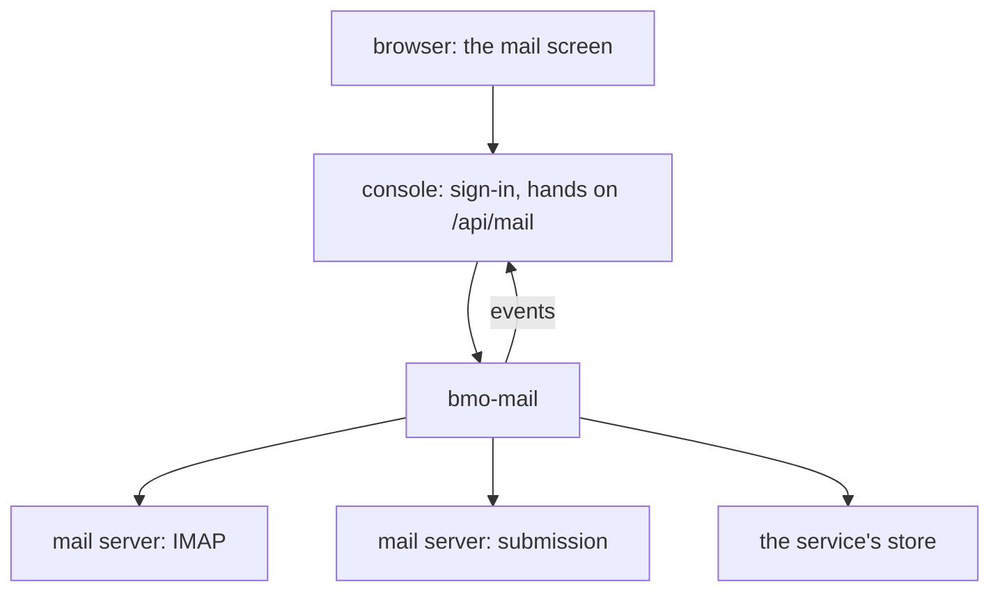

# Mail

The mail service and its screen: the mailboxes the accounts file names, read, written and watched
through this service's routes and through the console screen its plugin bundle carries, laid out the
way Gmail lays out its web client. This document is the canonical statement of what the service and
the screen do, where each piece of state lives and what belongs to the mail server rather than to this
repository. How the service is asked — its routes, events, store and settings — is `docs/api.md`.

## Scope

- **Accounts:** the accounts the accounts file names (「Accounts and credentials」). The code and the
  documents carry no address.
- **In the screen:**
  - Views: the inbox, the sent folder, drafts, spam, trash, starred, one view per label, any other
    folder the mailbox holds, and search.
  - Conversations grouped into threads, read and unread state, stars, labels, selecting many and
    acting on all of them at once, moving between folders, permanent deletion from trash and spam.
  - A list ordered by any of the columns its rows show, either way round, with the column widths
    dragged; and a filter that holds the list to what has not been read.
  - The sender's own logo beside their name, found where their domain publishes it.
  - Writing, replying, replying to all, forwarding, attachments both ways, drafts saved as the
    writing goes, and a short window to take a sent message back (undo send).
  - A signature per account, read receipts both ways, filter rules, spam reported and un-reported,
    a sender always sent to spam, address completion from the addresses already used.
  - New mail refreshing the open list, a notice on whatever console page is open, and a browser
    push on every device that receives the mail kind.
  - A small set of desktop keyboard shortcuts.
- **Left to the mail server (its operator's work, outside this repository):**
  - Judging spam by content. The service files mail into spam by its own rules and by a spam
    verdict header a filter on the server wrote; it does not classify content itself.
  - Vacation auto-reply. It needs a Sieve script run at delivery, which the server does not run
    while Postfix delivers straight into Maildir.
  - DKIM signing, one SPF record, a DMARC record.
- **Not built:**
  - Snooze and scheduled send. Both need a clock that sends or moves mail later, and a message
    must never depend on a process staying up past the moment it was written.
  - Gmail's category tabs and priority inbox. They need a trained classifier; a few personal
    mailboxes have no volume that would train one.
  - An archive action. The mailboxes have no archive folder, and the folder set is the one above.
  - Swipe actions on a phone. The console reads a sideways skim as scrolling everywhere else, and
    the sidebar drawer refuses horizontal drags for the same reason.
  - Several composers open at once, templates, encryption, a contacts manager, creating folders.

## The mail server

- **What it is:** the server the accounts file names. The service is written against Postfix 3.6
  delivering local mail straight into each user's Maildir and Dovecot 2.3 serving IMAP, with the
  accounts as system users logged in through PAM.
- **What the service relies on:**
  - IMAP over TLS with `IDLE`. Everything else is used only when the server advertises it after
    login; `MOVE` falls back to copy, flag and expunge, and threading and sorting are done by the
    service, never by `THREAD` or `SORT`.
  - Special-use folders: Dovecot marks `Drafts`, `Junk`, `Sent`, `Sent Messages` and `Trash`. The
    service finds each role by its special-use mark and falls back to those names. A role whose
    folder does not exist yet is created by the service the first time it is needed.
  - Submission with STARTTLS and authentication as the account's own login. The size the server
    advertises with `SIZE` is the ceiling of one message after encoding.
  - IMAP keywords, which carry labels. The server takes any keyword (`PERMANENTFLAGS` ends in
    `\*`), but Maildir keeps only 26 keyword names per folder in its files; a keyword past the 26th
    lives only in Dovecot's index and is lost when the index is rebuilt. Every keyword counts —
    `$Forwarded`, `$Junk`, `$NotJunk` and `$MDNSent` as much as a label's — so an account has at
    most 26 labels less those four, and the service refuses a label past that.
- **What the service never assumes:** that Postfix copies sent mail into `Sent` (the service appends
  the copy itself), that the server filters or runs Sieve at delivery, or that a second client
  leaves flags alone.

## Accounts and credentials

- **The accounts file** holds the servers and the logins, one per line, `#` lines ignored:
  - `imap <host> <port> <tls name>` and `smtp <host> <port> <tls name>`. The TLS name is the name
    the certificate is checked against when the host is an address; `-` means a plain connection,
    which only a stand-in server uses.
  - `account <address> <login> <password>`, one per account, in the order the screen lists them.
  - An account is named in the screen's addresses and the routes by its address's local part.
- **Which file:** the one the setting `accounts.file` names (`docs/api.md`, 「Settings」). The
  repository's own settings name none, so an instance run from source reaches no real mailbox
  because the setting was forgotten; a deployment names the data root's `env/mail-accounts` in its
  local settings.
- **A service with no accounts file** answers every route as having no accounts and watches nothing;
  the screen shows its empty state.
- **The file is read again** when it changed, so writing it takes effect without a restart. A file
  that exists but does not read is said in the service's log once per change, naming the line and
  never repeating it, since the line may hold a password.
- **The file is a secret:** it never enters the repository, a log line or a response. Only the
  address of each account ever reaches the browser.

## Where each piece of state lives

- **On the mail server,** so any other client sees the same thing:
  - Read state is `\Seen`, star is `\Flagged`, replied is `\Answered`, forwarded is `$Forwarded`,
    a draft is `\Draft`.
  - A label on a message is an IMAP keyword of the service's own form (`bmo_` and a short id), since
    a keyword is an ASCII atom and a label's name is not.
  - Spam reported and un-reported set `$Junk` or `$NotJunk`, the keywords a learning filter reads.
  - A read receipt answered, sent or declined, sets `$MDNSent`, so it is asked once.
  - Drafts are messages in the drafts folder; sent mail is a copy in the sent folder.
- **In the service's store** (`docs/api.md`, 「The store」), per account:
  - Labels: the keyword, the name, the colour, the order.
  - Filter rules: an ordered list of conditions and actions, each rule on or off.
  - Settings: the signature as the markup it is written in, whether read receipts are asked by
    default, whether a message's outside pictures are shown as it opens, and the senders always
    sent to spam.
  - The watcher's high-water mark: the folder's UID validity and the highest UID it has handled.
  - Known addresses: every address written to or received from, with its name and when it was
    last used, for completion.
  - Sender logos: one row per sender domain holding the picture found there or nothing found, and
    when the looking was done.
- **In the staging folder** the setting `staging.dir` names: uploaded attachments until the message
  carrying them is saved as a draft or sent; files older than a day are swept every hour.
- **In the browser the reading was done in:** how wide the list's sender and date columns were
  dragged. Everything else about how a list stands is in the address instead, so it travels with a
  link.
- **Nowhere:** message bodies are never copied out of the mail server. Every list and every thread
  is read from IMAP when it is asked for.

## Connections and the watcher

- **Two connections per account,** held by the service:
  - The watch connection stands in `IDLE` on the inbox.
  - The work connection answers the routes, one folder lock at a time. Each piece of work first
    brings the folder up to date, since the server takes mail that arrived since into a
    connection's view only at a command: without that, the first read after new mail would miss it.
  - The mail server's per-user connection limit must leave room for both.
- **A dropped connection** is opened again after a wait that starts at five seconds and doubles to
  a minute. A server that will not hold `IDLE` is asked for the inbox's state every thirty seconds
  instead.
- **When the inbox grows,** the watcher takes every message above its high-water mark, oldest first,
  and for each one:
  1. Runs the filter rules and the always-spam senders over it.
  2. Moves the mark past it, so a message is handled once even across restarts.
  3. Records the sender in the known addresses.
- **Then, once for all it took:**
  1. Says on the event stream that the account changed.
  2. Says on the event stream which messages arrived: those still in the inbox, unread and not from
     the account itself, with the notification they make (「Push」).
- **A message the service itself moved into the inbox is not new mail** — not spam, or a move to
  the inbox. The service notes where each such message landed, and the watcher waits for a move in
  progress to be noted before it handles anything; it moves the mark past a noted message without
  running the rules over it, recording its sender or saying it arrived. Mail another client moved in
  cannot be told from delivered mail and is handled as delivered.
- One handling runs at a time; mail that comes during one is taken by the next, straight after.
- **On start** the watcher handles whatever arrived while the service was down the same way, so a
  rule is never skipped. A first start with no mark, or a mark taken under another UID validity — a
  folder the server rebuilt — sets it at the newest message and handles nothing older.
- **The accounts file is read again every minute;** when it changed, the watchers stop and start
  again on what it now says.
- A flag or an expunge the server reports on the inbox only says that the account changed.

## Reaching the open tabs

- **The service says what changed on its event stream** (`docs/api.md`, 「The event stream」), and
  the console relays it into each tab's one event stream as its mail word. A mail word carries no
  cursor, so it never moves the tab's place in the console's own stream.
- The word says only which account changed. The tab then asks the mail summary — per account, the
  unread count of the inbox, the newest message and the newest unread ones, or that the account's
  server did not answer — and compares it with what it last knew. The summary marks a message the
  service moved into the inbox, and the tab raises no notice for it.
- **Nothing is lost to a dropped stream.** The tab asks the summary when a screen holding it mounts
  and each time the stream opens, so mail that arrived while it was closed is noticed then. A screen
  that listens only for mail holds the stream open on its own.
- **What the tab does with it:**
  - The mail screen open on that account refreshes its list and its folder marks, and shows no
    notice.
  - Any other page — the mail screen on another account included — raises a notice on the console's
    island naming the account, the sender and the subject, and pressing any of it opens the thread.
    Several messages at once make one notice per account with their number, and a second notice for
    an account replaces the first where it stands.
  - The sidebar's mail entry carries the unread mark while any inbox holds unread mail.

## Push

- **Mail is a notification kind of its own,** `mail`, received by a device unless it was turned off
  for that device, devices subscribed before the kind existed included. The console holds the kinds
  and the devices and rings them.
- One notification per account per arrival: the sender and the subject of the newest message, and
  the count when more came at once. Pressing it opens that thread, and a console already showing that
  place is not rung.
- The notification carries the address, the sender's name and the subject. Nothing of the body.
- **The service writes the notification** in its own words (`docs/api.md`, 「The service's own
  words」) and hands it on the event stream with the arrival; ringing it is the console's.

## Reading

- **A list** is a page of fifty messages, newest first, shown as the conversations they make up. For
  a folder the service reads the folder's messages in arrival order; for a view across folders —
  starred, a label, a search — it searches the inbox, the sent folder, the drafts folder and every
  other folder except spam and trash, and merges the results by arrival time. The range the
  toolbar shows counts messages, since counting a view's conversations would read the whole view.
- **A list stands on one column, one way round and one filter,** and all three are in the address,
  so a link opens the list as it was being read and Back steps between them. The columns are the
  ones the rows show: the sender, the subject and the date. The filter holds the list to what has
  not been read. A change of any of them starts the paging over, since the row that was fiftieth in
  one order is not the fiftieth in another; a change of folder does not, because how a list is read
  is not where it is read.
- **Ordering is the service's own work,** as threading is. Newest or oldest first over one folder
  is that folder's own order and is read by each message's place in it, which touches only the page
  asked for. Every other list — ordered by a sender or a subject, held to unread mail, or standing
  over more than one folder — is a search instead, and a sender or a subject is read from the
  envelope of every message the view holds before the page is cut out of it. So the list as it
  stands by default costs one page, and ordering a large folder by a name costs one reading of its
  envelopes.
- Names and subjects are compared as the service's language reads them (the setting
  `wording.language`) rather than by the order of their code points, and two that compare the same
  fall back to their dates.
- A conversation takes the place of its first message in that order, and what its row says of it —
  the date, the senders, the snippet — is read from the newest message of the group whatever the
  order is.
- A conversation whose messages fall on two pages shows on both, each row carrying the messages of
  its own page.
- **A conversation** is keyed by the first message ID in `References`, else `In-Reply-To`, else
  the message's own ID. A list groups the page's messages by that key; a thread gathers every
  message of the key from the inbox, the sent folder and the folder it was opened from.
- **A message** is read from its body structure: the text and HTML parts are fetched and decoded
  by their charset (`ks_c_5601-1987` read as `euc-kr`, an unknown charset as UTF-8), and the other
  parts are listed as attachments without being fetched.
- **Opening a thread marks it read.** The toolbar can mark it unread again.
- **HTML is sanitised in the browser** by DOMPurify, with a mail profile:
  - Scripts, frames, forms, embeds, `base`, `meta` and `link` are removed, and every event
    attribute with them.
  - Remote images, remote backgrounds and remote CSS URLs are held back; a bar over the body offers
    to show them for that message. A held image keeps its place in the layout but draws nothing,
    neither a broken-image mark nor its alternative text. The account's settings can say instead
    that a message opens with them already shown, and the bar then never stands.
  - `cid:` references are pointed at the service's inline-image route, as the console hands it on.
  - The result is shown in a frame with no scripts, a content policy that lets images in only from
    the console (and from the web once shown), and links that open a new tab. The frame grows to
    its content's height, so the thread region is the only thing that scrolls.
  - **A message that paints itself stands on a surface of its own.** A sender who set a background
    or a text colour anywhere in the markup wrote against a surface they chose, and that surface
    read together with the console's dark theme is what leaves grey text on white; so such a
    message is shown light — a white surface with dark text — whichever theme the console is in,
    and a message that set no colour at all is shown on the console's own surface and reads in
    either theme. The white surface fills the message card from edge to edge and holds its own
    padding inside, so no padding around it cuts the colour into a band.
  - **Every cell that carries its own background carries a text colour with it.** A sender who
    paints a cell and leaves its letters uncoloured would otherwise have them drawn in the colour
    the frame sets for everything else, which pairs with the frame's surface and not with the
    cell's: near-black letters on a navy header, or the console's pale grey on a white panel. So a
    cell that declares a background colour and no colour of its own is given the colour that reads
    against that background — dark letters on a light one, light letters on a dark one — and a cell
    that declares its own colour is left exactly as the sender wrote it. The pairing is the cell's
    own and does not turn on the console's theme, since the background it answers to does not
    either.
  - **The body wraps to the frame, and what cannot wrap is shrunk to fit.** A long address, a run
    of preformatted text, a box given a width in pixels: each is laid out to the frame's width and
    flows onto the next line inside it. What no wrapping can bring inside — a layout table whose
    cells will not narrow past a width of their own is the common case — is scaled down as a whole
    until it stands within the frame, the frame's height scaled with it, so the message keeps the
    proportions its sender drew. Nothing of the body is ever cut off at the frame's edge and
    nothing of it scrolls horizontally.
  - **A message too wide to shrink and stay legible scrolls instead of shrinking further.** The
    shrinking stops at half size; a message that would need less than that keeps half size and the
    remainder is reached by scrolling the frame sideways, which is a box of its own and not the
    screen. This is the only horizontal scroll a body has, and the mail screen around it never
    scrolls sideways.
- A plain-text message is shown as text, its lines kept and its links made links.
- **Attachments are served by the service** from the mail server as they are asked for, as a
  download with `nosniff` and a sandboxing content policy, never rendered inside the console's own
  origin.

## Sender avatars

- **The sender's own logo stands beside their name,** in a list's rows and at the head of an open
  message.
- **Where it is looked for,** in this order:
  1. The BIMI record of the sender's domain, which names the SVG that domain publishes as its mark
     for mail.
  2. The icon that domain's own site names in its head, and failing that the icon at the usual
     place under the domain.
  3. The same two, asked of the domain the sender's own sits under, where it sits under one: mail
     written from `mail.example.com` shows what `example.com` publishes, since the name a machine
     sends under rarely carries a site of its own. The climb goes to the domain somebody
     registered and no further, so a tail a registry keeps — `co.kr`, `com.au` — is never taken
     for a domain of its own and never asked for an icon.
  4. None of them: the screen's own identity mark for that address — a circle in a colour of the
     address's own carrying the first letter of the name the row shows. One address is always the
     same letter in the same colour, wherever in the console it stands, so a sender is recognised by
     it down the list and an account is recognised by it in the nav.
- **The service fetches it and the browser never does.** Nothing reaches the sender when a message
  is read, which is the standard the body's outside pictures are held to; the browser asks the
  service's route through the console, and that route answers with a picture or with nothing.
- Gravatar is not used. It is asked for by a hash of the recipient's address, which would send the
  account's own address out of the machine to be recognised.
- **A logo's address is a stranger's word,** since the sender publishes the record it comes out of.
  A lookup goes only to an ordinary HTTPS address on the open web and never to one of this
  machine's own networks, and each hop of a redirect is asked that again before it is taken.
- **What comes back is checked before it is kept:** a type a browser draws, a size an icon could
  have, and no SVG carrying a script, a document of its own, or anything it would itself go and
  fetch. Such a file is dropped rather than cleaned. It is served with a policy that sandboxes it
  and a type that is not sniffed, and every place that shows it shows it as a picture.
- **A lookup is made once and kept.** What was found, and that nothing was, is kept in the store,
  so a page of fifty rows is not fifty lookups; a domain with no logo is not asked again for a day,
  and a logo found holds for a week. Two rows of one domain drawn at once wait on one lookup. The
  domain a sender sits under is looked up as a sender domain in its own right, so it is held and
  waited on the same way and senders sharing one main domain ask it once between them; what the
  climb found is kept under the sender's own domain too, which is what makes the next list of that
  sender no lookup at all.
- Publishing a BIMI record for the accounts' own domains is the sending side, and is not this
  service's work.

## Search

- One box, over the account open in the screen. Gmail's operators are understood and turned into
  an IMAP search: `from:`, `to:`, `subject:`, `label:`, `in:`, `is:unread`, `is:read`,
  `is:starred`, `has:attachment`, `before:` and `after:` with a date. The remaining words search
  the whole text.
- A search is a view like any other: its query is in the address, and its results are
  conversations.

## Writing

- **One composer at a time.** Opening another while one is open saves the first as a draft and
  replaces it.
- **Fields:** from (the accounts), to, cc and bcc with completion from the known addresses,
  subject, body, attachments, and the read-receipt switch. Each field's label stands in a column of
  its own, wide enough to hold the longest of them on one line, and the field takes the rest of the
  row; an address too long for its row is cut inside its own chip rather than carrying the row past
  its edge.
- **Cc and bcc open from the to field.** They start folded away, stand open while either holds an
  address, and fold away again when the body is written in with both of them empty.
- **The body is rich text** written in the screen's own mail editor, sent as HTML with a plain-text
  alternative. The account's signature is placed under a separator when the composer opens.
- **One editor writes both the body and the signature.** It is built on Nuxt UI's editor and carries
  undo and redo, the headings, bold, italic, underline and strike, a text colour, the alignments,
  the lists with quote and code, a link, a picture, a table with its own menu for rows, columns and
  cells while the cursor is in one, a rule, and clearing the formatting. Its toolbar is the
  console's own toolbar row.
- **The editor is loaded apart from the mail screen.** Its rich-text engine would otherwise be most
  of what the screen loads before it is drawn, so the screen stands without it and fetches it once
  it is drawn and the browser is idle. A composer or a signature opened before it has arrived
  shows the toolbar row with a bar for each mark over the writing surface's full height, with the
  placeholder where nothing is written yet; a load that failed says so in the editor's place.
- **A picture is carried in the markup as its own bytes** — chosen from the picture menu, pasted or
  dragged in, and capped at two megabytes each. A signature has no message to hang an attachment
  on and a draft must survive being saved and reopened, so nothing is uploaded for one; the message
  that goes out turns each such picture into an inline part and points the markup at it by its
  content id, which is how a signature's picture arrives with the mail.
- **Reply and reply-all** set `In-Reply-To` and `References`, prefix the subject once with
  `Re:`, quote the message under the new text with an attribution line in the service's own words,
  and mark the original `\Answered` once sent. A reply to a message the account itself sent goes to
  that message's recipients, as a follow-up. **Forward** prefixes `Fwd:`, heads the quoted original
  with its sender, date, subject and recipients in the service's own words, carries the original's
  attachments, and marks it `$Forwarded`.
- **Attachments** are uploaded to the staging folder as they are added. A forwarded or
  draft-held attachment is referred to as a part of a message on the server. The total is capped so
  the encoded message stays under the server's `SIZE`; a file past that is refused before upload.
- **Drafts are saved as the writing goes** — a few seconds after typing stops, and when the
  composer closes. A save writes the new draft first and deletes the one it replaces afterwards, so
  a failed save never loses the older copy. A reopened draft is parsed back into the composer
  with its attachments.
- **Sending** saves the draft, then holds the message for ten seconds in the service while a notice
  on the island offers undo send for exactly that long. Taking it back reopens the draft. After the
  hold the service sends it over submission, appends the copy to the sent folder read, deletes the
  draft and records the recipients as known addresses. A service that stops during the hold leaves
  the draft in drafts, never a half-sent message.

## Read receipts

- **Asking:** the composer's switch adds `Disposition-Notification-To` with the sender's address.
  Its default is the account's setting.
- **Answering:** a message that asks shows a bar over its body offering to send the receipt or not.
  Nothing is ever sent without that press. Sending it sends a disposition notification (RFC 8098)
  from the account the message came to, its subject and words in the service's own words. Either
  answer sets `$MDNSent`.

## Filters and spam

- **A filter rule** is conditions joined by all or any — sender, recipient, subject containing a
  text, or a header holding a value — and actions: add a label, star, mark read, move to a folder,
  move to spam, move to trash. Rules run in order, and one that moves the message ends the run.
- **A spam verdict written on the server** is a condition like any other; the settings offer a
  ready rule for `X-Spam-Flag: YES` and `X-Bogosity: Spam`, which is how a filter installed on the
  server later reaches the screen without a change here.
- **Reporting spam** moves the selection to spam and sets `$Junk`; its dialog can add the senders to
  the always-spam list. **Not spam** moves it back to the inbox and sets `$NotJunk`.
- A rule can be run over the folder that is open, for the mail that came before it existed.

## The screen

- **Addresses:** `/mail/<account>/<view>` and `/mail/<account>/<view>/<thread>`, where the account is
  the address's local part and a view is a folder role, `starred`, `label/<id>`, `folder/<name>` or
  `search?q=`. Opening a thread is a history step, so a shared link opens the same thread.
- **Desktop (1440px):** three regions side by side behind Splitters, each scrolling on its own:
  1. **Mail nav** — the account switch (each account with its unread mark), compose, the folder
     roles, starred, the labels with their colours, the other folders, and the settings button. It
     folds to icons; folded, the unread mark is drawn over its row's icon rather than beside it, so
     every row's icon stands on one centre whether it carries a mark or not. An account stands as
     its own avatar rather than as an account icon — the first letter of its local part on the
     colour that address carries everywhere in the console — because the accounts are identities and
     folded they would otherwise be one icon repeated. The domain's logo is never that avatar:
     accounts of one domain would all wear it. An address is longer than the panel is wide, so the
     row cuts it and names it on hover at every width rather than folded alone; nothing in the nav
     moves.
  2. **List** — the search box on top, the toolbar under it, then the conversations.
  3. **Thread** — the subject on a row of its own; under it the labels on the left and reply,
     reply all and forward on the right, which answer the newest message; then the messages, the
     newest and every unread one open and the others folded to a line each. Each open message
     carries a menu with the same three, answering that message. With nothing chosen it holds a
     one-line empty state.
- **Opening a conversation reads that conversation and nothing else.** The folder panel and the
  list are not asked for again — only the selection moves — and a conversation opened once stands
  straight away when it is opened again, read behind it rather than under a skeleton. A skeleton is
  for a first reading alone.
- **A conversation in drafts** opens in the composer, to be written on, rather than as a thread.
- **The list toolbar** spans the list edge to edge, groups divided by dividers:
  - Selection: the select-all checkbox with its menu (all, none, read, unread, starred, unstarred),
    refresh, mark all read and unread only, which give their place to the selection's actions while
    anything is chosen. Mark all read marks every unread message of the view read — the whole
    folder, label or search, not only the page the list has read — and says how many it marked;
    what is chosen is read by mark read instead. Unread only is a state the button itself shows,
    since a list holding only part of what it names must say so wherever it is read.
  - With a selection: state (read or unread, star), place (trash, report spam or not spam, move)
    and labels. Each group is three icons or fewer with tooltips; move opens the console's menu of
    the places mail can go, and labels a popover of checkboxes, both at the button. In trash and
    spam, delete forever takes the place of trash. A change of state or labels leaves the selection
    chosen for the next action; a change of place empties it.
  - **The bar gathers by the room it has**, which is this panel's and not the window's: this list
    stands beside a thread and is often narrower than a phone on a wide screen. Short of that room
    the bar keeps the select-all checkbox and its menu, and folds refresh, mark all read, unread
    only and sort into one more menu; with a selection it keeps trash and mark read and folds star,
    spam, move and labels into the same one menu a phone's row carries. The reading is bmo-ui's
    action bar's, so the bar takes the same shape wherever it ends up this narrow.
  - At the right end: the range shown (`1–50 / 1,213`, tabular) with previous and next. In a list
    narrower than its cells need, the range steps aside while anything is chosen, so every action
    of the selection stays in view.
- **A list row on one line** stands in the columns the header names: a leading cell holding the
  checkbox, the star, the unread mark and the sender's avatar; the sender with the thread's count;
  the labels with the subject and snippet; the attachment mark; and the date. A row's words are cut
  at the width their cell has and nothing on the row moves: the subject is what the row is read by,
  and the whole of it, with the message under it, opens on a press. The subject is the only cell
  that grows and takes everything the others leave; the sender and the date take what their own
  contents ask for, capped, and each stands at one width down the whole list. Unread rows are bold
  and carry the unread mark.
- **Where one line stops fitting** is read off the cells rather than set as a width. A row stands on
  one line wherever the list holds the fixed cells — the padding, the leading cell, the attachment
  mark and the gaps — the date at its width, the sender at its floor and a subject of ten rem, the
  least that still says which thread it is. Short of its own width the sender gives way first,
  down to that floor, so the subject is the last cell cut; only past that does the row take the
  phone's two lines. Beside the thread at the default split this is a desktop window about
  1,900 pixels wide, and any narrower one that folds the sidebar or drags the list wider.
- **The column header** stands over a list whose rows are one line and sticks to the top of it; over
  rows that stack it is not drawn at all, since there is no column for a name to stand over.
  Pressing a column orders the list by it, and pressing the one it already stands on turns that
  column round; a date opens at its newest and a name or a subject at its first. The trailing edge
  of the sender column and the leading edge of the date column are dragged to set those widths, and
  what they were dragged to is kept in that browser; an edge pressed twice puts its column back to
  what the rows ask for.
- Where there is no header — a phone, or a list too narrow for one line — the toolbar's sort offers
  the same three columns and the same turning round.
- **The composer** is a panel docked at the bottom right of the mail screen, with minimise, maximise
  and close in its header; maximise makes it a centred large modal. Its footer holds the attachment,
  read-receipt and discard icons and the send button at the right. A half-written message is not
  thrown away by a press beside it, so neither the modal nor the drawer closes on a press outside
  itself and the drawer is dragged shut by its grabber alone; the back gesture closes any of the
  three and the draft is saved on its way out.
- **A phone in portrait:**
  - The body is the list, and it never leaves it. A thread opens over the list rather than in its
    place — one history step all the same, so a link opens it and Back closes it — and because the
    list was never taken down, the scroll, the selection and the page it had read are where they
    were when the thread closes. While the thread stands, the list under it is out of reach.
  - The mail nav is a bottom drawer opened from the folder button at the left of the search row; the
    search box shares that row, and the list's toolbar is the one row under it.
  - A row is two lines with the sender's avatar at the left of both: the sender and the date, then
    the labels, the subject and snippet; the star stands at the right.
  - A long press enters selection mode, a state Back leaves; a finger that goes on from that press
    chooses every row it passes and carries the list along at its top and bottom edges. A list
    already choosing is held again on any row: that row is chosen, what was chosen stays, and the
    drag carries on from there — so the list is scrolled and held as many times as the choosing
    takes. The toolbar becomes the select-all checkbox, the selection's count, trash, mark read, one
    menu with the rest, and end choosing at the far end. The checkbox is the first thing in the row,
    so it stands on the same vertical line as the marks down the rows it speaks for, and it is the
    same one the wide toolbar carries, so the whole page is taken or given up at either width.
  - Compose is a button fixed at the bottom right, and the list keeps room at its foot for it, so
    the last row is never under it however far down the list is read. The composer is a full-height
    bottom drawer, and Enter in its body makes a new line.
- **The settings** — signature, images, read receipts, filters, labels, spam senders — are one modal
  with a section each, opened from the mail nav; on a phone it is a bottom drawer. Signature, images
  and read receipts are a form, saved together by the one save at the foot, and closing with changes
  asks first; a filter, a label and a spam sender are records, each saved as it is added, changed,
  moved or removed. The signature is written in the same editor the body is, so a picture or a
  table goes into it; images says whether a message's outside pictures are shown as it opens or held
  behind the bar over the body.
- **Keyboard (desktop only):** `c` compose, `/` search, `j` and `k` next and previous, `x` select,
  `s` star, `#` trash, and in a thread `r` reply, `a` reply to all, `f` forward. None fires inside
  a text field.
- The folder list shows a status mark for unread mail, not a count; the count of the open folder
  stands in the list toolbar's range.
- **Every word the screen shows** is the bundle's own language pack (`docs/api.md`, 「The console
  plugin bundle」); a refusal of a route is shown by its code in the pack's words.

## A stand-in mail server

- **No development instance and no test touches real mailboxes.** The old checks ran against a
  stand-in: a throwaway Dovecot container of the 2.3 line, declared as the real server declares its
  folders, with example accounts on the reserved `standin.example` domain, and an SMTP stand-in that
  hands mail for those addresses to the container and relays nothing anywhere.
- **The stand-in is deferred with the tests** (`docs/inventory.md`). It is written again here when the
  tests are. Until then a development instance runs with no accounts file, or with one naming a mail
  server set up for it.

## Outside this repository

What the mail server's operator does by hand, in this order:

1. Write the accounts file the deployment's `accounts.file` names: the IMAP and submission hosts
   with the certificate's name as the TLS name, and the logins with their passwords.
2. Confirm the IMAP server's per-user connection limit leaves room for two connections per account
   from the service besides the account's other clients.
3. Put a content spam filter at delivery — Postfix delivering through Dovecot's LDA or LMTP with
   Sieve lets it tag or file mail — so the spam-header rule has a verdict to read.
4. With Sieve at delivery, vacation auto-reply becomes possible; it is a later item of its own.
5. Publish one SPF record, a DKIM key with Postfix signing, and a DMARC record for the sending
   domain, so mail sent from the service is not itself filed as spam elsewhere.
