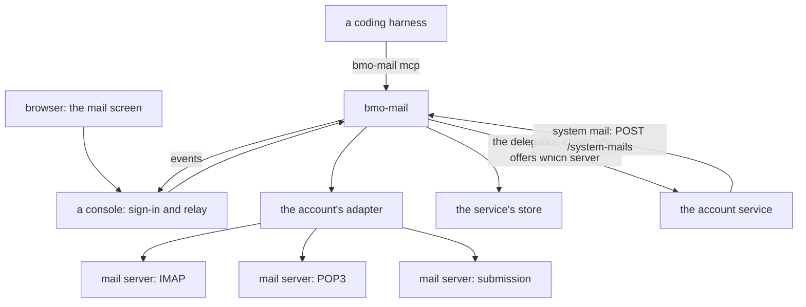
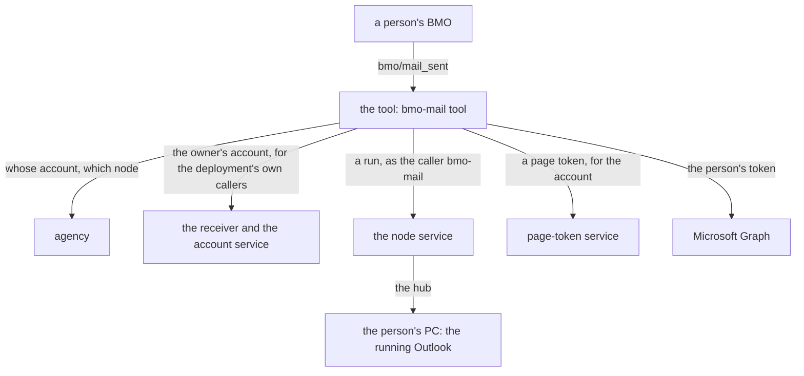

# Mail

The mail service and its screen: each login account's own mailboxes, added from the screen, read,
written and watched through this service's routes, through the MCP server a coding harness takes it by,
and through the console screen its plugin bundle carries, laid out the way Gmail lays out its web client.
This document
is the canonical statement of what the service and the screen do, where each piece of state lives and
what belongs to the mail server rather than to this repository. How the service is asked — its routes,
events, client, harness plugin, store and settings — is `docs/api.md`.

Beside the service stands its hosted tool, which reads what a person sent from their own machine and touches
neither the service nor its store (「A person's sent mail, read on their own machine」).

## Scope

- **Accounts:** each owner's own list of mail accounts, added, changed and removed from the screen
  (「Accounts and credentials」). The code and the documents carry no address.
- **Mail servers:** the incoming and outgoing servers accounts are reached through, each kept once as a record of
  its own and chosen by any number of accounts: the platform's and an organisation's, offered down the organisation
  tree, and a person's own (「Mail servers」).
- **The platform's system mail:** one mail at a time the account service sends through an outgoing server of the
  platform's — a reset link, an email's verification, a security notice (「The platform's system mail」).
- **In the screen:**
  - Views: the inbox, the sent folder, drafts, spam, trash, starred, one view per label, any other
    folder the mailbox holds, and search.
  - Conversations grouped into threads, read and unread state, stars, labels, selecting many and
    acting on all of them at once, moving between folders, permanent deletion from trash and spam.
  - A list newest first, with the column widths dragged; and a filter that holds the list to what
    has not been read.
  - The sender's own logo beside their name, found where their domain publishes it.
  - Writing, replying, replying to all, forwarding, attachments both ways, drafts saved as the
    writing goes, and a short window to take a sent message back (undo send).
  - A signature per account, read receipts both ways, filter rules, spam reported and un-reported,
    a sender always sent to spam, address completion from the addresses already used.
  - New mail refreshing the open list, and a notice on whatever console page is open, raised by the
    console from the kind the bundle's manifest names.
  - A small set of desktop keyboard shortcuts.
- **A person's own sent mail, read on their own machine:** the hosted tool that tells a person's BMO what
  that person sent on a day, from the Outlook they are signed in to on their own PC, else through Microsoft Graph
  (「A person's sent mail, read on their own machine」). It reads no account of this service.
- **Left to the mail server (its operator's work, outside this repository):**
  - Judging spam by content. The service files mail into spam by its own rules and by a spam
    verdict header a filter on the server wrote; it does not classify content itself.
  - Vacation auto-reply. It needs a Sieve script run at delivery, which the server does not run
    while Postfix delivers straight into Maildir.
  - DKIM signing, one SPF record, a DMARC record.
- **Not built:**
  - Snooze and scheduled send. Both need a clock that sends or moves mail later, and a message
    must never depend on a process staying up past the moment it was written: a send waits at most
    the account's undo span.
  - Gmail's category tabs and priority inbox. They need a trained classifier; a few personal
    mailboxes have no volume that would train one.
  - An archive action. The mailboxes have no archive folder, and the folder set is the one above.
  - Swipe actions on a phone. The console reads a sideways skim as scrolling everywhere else, and
    the sidebar drawer refuses horizontal drags for the same reason.
  - Several composers open at once, templates, encryption, a contacts manager, creating folders.
  - On a `pop3-smtp` account (「A POP3 account」): moving mail between folders, spam and not spam,
    trash, deleting for good, and a copy of each message sent. A POP3 server holds the inbox alone, with
    no sent, spam or trash folder to move into or copy to; the routes refuse a move, and the screen offers
    none of them on such an account.

## The mail server

- **What it is:** the server an IMAP/SMTP account names. The service is written against Postfix 3.6
  delivering local mail straight into each user's Maildir and Dovecot 2.3 serving IMAP, with the
  accounts as system users logged in through PAM.
- **What the service relies on:**
  - IMAP over TLS with `IDLE`. Everything else is used only when the server advertises it after
    login; `MOVE` falls back to copy, flag and expunge, and threading and sorting are done by the
    service, never by `THREAD` or `SORT`.
  - Special-use folders: Dovecot marks `Drafts`, `Junk`, `Sent`, `Sent Messages` and `Trash`. The
    service finds each role by its special-use mark and falls back to those names. A role whose
    folder does not exist yet is created by the service the first time it is needed.
  - Submission with STARTTLS and authentication as the account's own login. The size the server
    advertises with `SIZE` is the ceiling of one message after encoding.
  - IMAP keywords, which carry labels. The server takes any keyword (`PERMANENTFLAGS` ends in
    `\*`), but Maildir keeps only 26 keyword names per folder in its files; a keyword past the 26th
    lives only in Dovecot's index and is lost when the index is rebuilt. Every keyword counts —
    `$Forwarded`, `$Junk`, `$NotJunk` and `$MDNSent` as much as a label's — so an account has at
    most 26 labels less those four, and the service refuses a label past that.
- **A POP3 server,** for an account of the kind `pop3-smtp`: POP3 over TLS (RFC 1939) signed in with `USER`
  and `PASS`, and `UIDL`, which the service tells a new message from one it has seen by; a server that does
  not answer `UIDL` is refused at sign-in. `TOP` is used where the server answers it, and the whole message
  read where it does not. Submission is the same as for an IMAP account.
- **What the service never assumes:** that Postfix copies sent mail into `Sent` (the service appends
  the copy itself), that the server filters or runs Sieve at delivery, or that a second client
  leaves flags alone.

## Accounts and credentials

- **An account belongs to an owner.** The owner is named by an opaque owner key the caller passes
  with every request (`docs/api.md`, 「Who checks what」); the service never reads the console's login
  accounts and checks nothing of the key but that it is given. Each owner has a list of their own, in
  the order they put it. One owner key never sees, reads or changes another's account: every route
  under an account answers an owner who does not hold it as if the account did not stand.
- **An account is of a kind,** the name of the adapter that reaches its mailbox. Each adapter declares
  its kind: how an account of it signs in, the fields a person writes to add one, and, for a kind reached
  through mail servers, the protocol of the incoming server it reads and of the outgoing server it sends
  through. The screen, the routes and the tools know no adapter: they read the kinds the service declares, and
  the service finds an account's adapter by its kind alone.
  - `imap-smtp`: a mailbox reached over IMAP and submission, signed in with a login and a password. Its
    fields are the login (the address where none is written) and the password; it reads an incoming server of
    the protocol `imap` and sends through an outgoing server of the protocol `smtp` (「Mail servers」).
  - `pop3-smtp`: a mailbox reached over POP3 and submission, signed in with a login and a password, for a
    mailbox whose server offers no IMAP. Its fields are those of `imap-smtp`, and it reads an incoming server of
    the protocol `pop3`. What its mailbox offers is 「A POP3 account」.
- **An account reached through mail servers names two of them:** one incoming server, of the protocol its kind
  reads, and one outgoing server. Its own are the address, the login and the password; where it connects, how
  and over what security is the servers' (「Mail servers」). An account is added only on servers its owner
  reaches, and where the kind is not named it is the one whose incoming protocol is the incoming server's.
  - `gmail` (the Gmail API) and `graph` (Microsoft Graph): a provider signed in through its own
    authorization page, the service keeping the tokens it hands back. Their contract stands in
    `docs/api.md`, 「Accounts」; until an adapter of the kind is built into the service, the service
    does not declare the kind and no account of it can be added.
- **Adding an account signs in first.** The service checks the account against its servers — for
  `imap-smtp` a login to IMAP and to submission — and keeps it only when they took it; an account
  whose sign-in failed is refused, and nothing of it is kept. For `pop3-smtp` the sign-in is a login to
  POP3 that answers `UIDL`, then to submission. Changing an account's address, login, password or servers
  signs in again the same way; an outgoing server that takes mail without a sign-in is greeted and asked its
  capabilities alone.
- **An account's name** is the local part of its address unless the person gives it another. It is
  unique among one owner's accounts and matched without regard to case; the routes and the screen's
  addresses name the account by it.
- **What is secret:** a password, and a provider's tokens. They are kept in the store encrypted with
  AES-256-GCM, a fresh nonce for each sealing and the account's id bound into it, under a key the
  service reads at start from the key file the setting `secrets.key_file` names: 32 random bytes
  written as base64 on one line. The key file is the deployment's, the data root's
  `env/mail-secrets.key`, and never enters the repository. A secret is never answered, never written
  into a log line and never reaches the browser: of an account only its name, kind, address and the
  settings that are not secret are answered.
- **Without a key file** the service keeps no account: the list is empty and adding one is refused as
  not ready. A key file named but missing or unreadable, a key that does not open the accounts kept, or
  a store holding accounts while no key file is named, stops the service at start rather than leave
  accounts it cannot open.
- **Choosing how a mailbox is reached is choosing the kind.** An account names one kind, chosen when it is
  added — by the incoming server chosen, for a kind reached through mail servers — and the kinds are offered in
  their names' order, `imap-smtp` first. An account changes its servers, its login and its password within its
  kind: another incoming server of the same protocol is a change, one of another protocol is refused, and
  reaching the same mailbox by another protocol is removing the account and adding it again as the other kind.
- **Removing an account** forgets it and everything the store holds for it — its labels, rules,
  settings, spam senders, the watcher's mark, the known addresses and a POP3 account's messages and
  drafts — takes back its sends still waiting, and lets its connections go. Its mailbox on the server
  is untouched.

### The accounts file, imported once

- **A deployment that read its mailboxes from an accounts file moves them into the store once.** At
  start, while no import has been made, the service reads the file the setting `accounts.file` names
  and keeps each account it names as an `imap-smtp` account of the administrator's owner key, in the
  file's order, its password encrypted, on the file's IMAP and submission servers kept as the administrator's
  own server records — a record the administrator already holds with the same settings is taken rather than
  made again (「Mail servers」). What the store already kept for each account's address —
  labels, rules, settings, spam senders, the watcher's mark, the known addresses and the event window
  — stays that account's, so nothing it had is lost. The import is recorded, and from then on the file
  is not read again.
- **The file's lines** are the service's own syntax: `imap <host> <port> <tls name>` and
  `smtp <host> <port> <tls name>`, `-` as the TLS name for a plain connection, then
  `account <address> <login> <password>`, one per account; blank lines and `#` lines are passed over.
  A file that does not read is said in the log naming its line and never repeating it, since the line
  may hold a password, and nothing is imported.
- **The administrator's owner key** is read from the setting `accounts.administrator`. The imported
  accounts are that key's; a change of the setting carries the accounts and the own servers the earlier key
  held to the new one at the next start. With no administrator key or no key file, the import waits, said in the
  log, and the file stays unread.

## Mail servers

A mail server is kept once, as a record of its own, and chosen by any number of accounts: a company sets its IMAP
and submission servers one time, and each of its people adds only their address and password.

- **A server is incoming or outgoing, by its protocol.** An incoming server is read over `imap` or `pop3`, an
  outgoing one is handed mail over `smtp`, submission. Each record holds:
  - its name, what a person chooses it by, the host where none is given;
  - its host and its port, the protocol's usual port for its security where none is given — 993 for IMAP over
    TLS and 143 otherwise, 995 for POP3 over TLS and 110 plain, 587 for submission with STARTTLS, 465 over TLS
    and 25 plain;
  - its security: `tls`, spoken from the first byte; `starttls`, upgraded after the greeting; or `none`, a plain
    connection, which only a stand-in server or a relay on the machine itself uses. IMAP and submission take all
    three; POP3 takes `tls` and `none`, since the POP3 client upgrades no session. The default is `tls` for an
    incoming server and `starttls` for an outgoing one;
  - the name its certificate is checked against, the host where none is given;
  - its sign-in: `password`, the account's login and password, which every incoming server takes; or, for an
    outgoing server alone, `none`, a server that takes mail without a sign-in.
- **A server never holds a secret.** The login and the password are each account's own and stay sealed on the
  account (「Accounts and credentials」); a server record is no secret, and is answered whole to whoever reaches
  it.
- **Who holds a server.** Every record stands under one holder:
  - **a person's own:** the owner key that made it, which alone reads, changes and chooses it;
  - **the platform's, or a company's or a unit's:** a link of the account service's delegation chain (bmo-web's
    `docs/accounts.md`, 「The delegation chain」), offered to every person whose chain the link stands on — the
    platform's to everyone, a company's to everyone of the company, a unit's to the people whose home unit is
    at or under it.
- **The chain says who offers what, and who may change it.** The service declares the chain's kind
  `mail.servers` as it stands: a `json` value, `layered`, at the platform's link and a unit's, a unit's link
  written by its heads. A link's value is the list of the servers it holds, which the service alone writes, in
  the name of the person changing them, every time a server of that link is added, changed or removed — so who
  may change a link's servers and whether a lock above withholds it are the account service's word, and a write
  it refuses leaves the server as it stood. A unit that locks the kind holds its servers for everyone under it:
  the units below it change none, and the servers they held stay kept and are offered to nobody until the lock
  is lifted.
- **What a person reaches** is read afresh for each list and each choice: the servers of every link on their
  chain the account service resolves, down to the link whose lock cuts it, and their own. Their organisation's
  stand first, the company's and then each unit's down to their own unit, then the platform's, then their own.
  A person the account service does not know — an owner key that is no user, the harness's — reaches the
  platform's servers and their own; a service whose settings name no account service keeps no server of a link
  and offers the person's own alone.
- **An account keeps the servers it was added on.** A person who leaves a unit keeps the accounts on its servers;
  the servers are no longer offered to them for another account.
- **A change of a server reaches every account on it,** at the next connection each one opens: the watchers
  follow at once and the work connections open again on the new settings. No account signs in again; the
  connection test says beforehand whether the server answers (「The screen」).
- **A server some account stands on is not removed.** It answers how many accounts stand on it, every owner's
  together and none named, and a removal is refused while that count is not zero.
- **A connection test** opens a connection to a server — kept, or as a form holds it before it is kept — with its
  security, reads its greeting and, where a login and a password are given, signs in, and lets go. It answers
  whether the server was reached and whether it took the sign-in, never what it was signed in with.
- **The accounts kept before servers were records** were moved onto them once, by the store's migration: each
  account's IMAP or POP3 settings and its submission settings became server records of its owner's own, one
  record for every set of identical settings an owner held — the same protocol, host, port, security and
  certificate name — so every account of one owner on one server points at one record. The security was read
  as each connection was made: a certificate name of `-` is `none`; else IMAP on 993 and submission on 465 are
  `tls`, POP3 is `tls`, and every other port is `starttls`. Each account kept its login and its password.

## The platform's system mail

The platform sends mail of its own — a reset link, an email's verification, a security notice — through one of the
platform's outgoing servers. The account service decides when such a mail goes, who reads it and in what words
(bmo-web's `docs/accounts.md`, 「The platform's own mail」); this service only hands it to the server.

- **The system mail is the platform administrator's alone.** It is set on the console's platform settings, and
  its outgoing server is one of the platform's own server records, never a company's, a unit's or a person's.
  This service holds to that at every send: a send naming any server but one of the platform's outgoing servers
  is refused.
- **The account service asks this service, under a credential of its own,** the one the setting
  `system_mail.token` names (`docs/api.md`, 「System mail」): the outgoing servers it may choose from, which are
  the platform's alone, and one send at a time.
- **A send names everything it goes with:** the platform's outgoing server, the sender's address and name, the
  name of the secret it signs in with, the recipient, the subject, the text and the HTML, and the kind of mail
  it is. Nothing of it is kept: the service keeps no copy, no row and no event, and its log names the kind and
  the server, never an address or a word of the mail.
- **The secret is named, never handed over.** It is a secret of the platform's space of the secret store, the
  folder the setting `system_mail.secrets_dir` names — the data root's `env/` — a file of `USERNAME` and
  `PASSWORD` lines, each line's key before its first `=` and its value exactly as written after it. The service
  reads it at the send and keeps nothing of it. A send that names no secret goes only through a server that
  takes mail without a sign-in.
- **A send goes at once,** with no undo span and no waiting: the account service hears it went, or the
  server's refusal in a sentence of its own.
- **Where this service is not installed,** or its settings name no credential for the account service, there is
  no system mail, and the account service offers what stands in its place: the administrator's one-time link.

## Where each piece of state lives

- **On the mail server,** for an IMAP account, so any other client sees the same thing:
  - Read state is `\Seen`, star is `\Flagged`, replied is `\Answered`, forwarded is `$Forwarded`,
    a draft is `\Draft`.
  - A label on a message is an IMAP keyword of the service's own form (`bmo_` and a short id), since
    a keyword is an ASCII atom and a label's name is not.
  - Spam reported and un-reported set `$Junk` or `$NotJunk`, the keywords a learning filter reads.
  - A read receipt answered, sent or declined, sets `$MDNSent`, so it is asked once.
  - Drafts are messages in the drafts folder; sent mail is a copy in the sent folder.
- **In the service's store** (`docs/api.md`, 「The store」), the mail servers, each with its holder
  (「Mail servers」), and the accounts themselves: each one's owner key, name, kind, address, place in its
  owner's list, settings, incoming and outgoing server, and its secrets sealed (「Accounts and credentials」).
  Then, per account:
  - Labels: the keyword, the name, the colour, the order.
  - Filter rules: an ordered list of conditions and actions, each rule on or off.
  - Settings: the signature as the markup it is written in, whether read receipts are asked by
    default, whether a message's outside pictures are shown as it opens, how long a send waits
    before it goes, and the senders always sent to spam.
  - The watcher's high-water mark: the folder's UID validity and the highest UID it has handled.
  - The arrivals the watcher took that are still owed their `message.created`.
  - Known addresses: every address written to or received from, with its name and when it was
    last used, for completion.
  - For a POP3 account, each message the maildrop holds: its `UIDL`, the number the service gave it,
    when it arrived, its size, its head, its flags and labels, and, once it was read whole, its parts
    and its snippet; and its drafts, each the whole message as it was last saved, until it is sent or
    thrown away (「A POP3 account」).
  - Sender logos: one row per sender domain holding the picture found there or nothing found, and
    when the looking was done.
- **On the account service's delegation chain,** the list of servers each link of the platform and the units
  holds, written by this service alone (「Mail servers」).
- **In the staging folder** the setting `staging.dir` names: a file posted to a draft until the draft
  carrying it is saved; files older than a day are swept every hour.
- **In the store's event window:** the events of the last day, so a reader that was away resumes
  where it stopped.
- **In the browser the reading was done in:** how wide the list's sender and date columns were
  dragged. Everything else about how a list stands is in the address instead, so it travels with a
  link.
- **Nowhere:** the bodies and attachments of mail the server holds are never copied out of it. Every list
  and every thread of an IMAP account is read from IMAP when it is asked for, and every body of a POP3
  account from POP3. A POP3 account's drafts are the one message the store holds whole, since its server
  has nowhere to keep them, and a message sent is kept nowhere.

## Connections and the watcher

- **Two connections per `imap-smtp` account,** held by its adapter:
  - The watch connection stands in `IDLE` on the inbox.
  - The work connection answers the routes, one folder lock at a time. Each piece of work first
    brings the folder up to date, since the server takes mail that arrived since into a
    connection's view only at a command: without that, the first read after new mail would miss it.
  - The mail server's per-user connection limit must leave room for both.
- **No clock ends a conversation with a mail server.** Opening a connection — the greeting, STARTTLS
  and the login — every IMAP command and every step of a submission wait for the server's answer,
  however long it takes. A conversation ends on that answer, on the server refusing or closing the
  connection, or on the connection breaking. Every IMAP and submission connection carries TCP
  keep-alive probes, so a server that is gone, or a network that lost the connection without a word,
  breaks the connection instead of leaving it waiting.
- **A read through the work connection that fails on the server's side** — a connection the server
  closed while it stood unused, a pipe that broke — is asked once more on a connection opened again,
  and the journal says so; a second failure is the read's answer. A write is never asked twice, since
  the first may have taken.
- **A dropped watch connection** is opened again after a wait that starts at the settings'
  `watcher.retry_ms`, five seconds by default, and doubles to a minute, and the journal says each time
  it dropped and each time it stands again. The connection opened again takes whatever arrived above the high-water mark while nobody watched, as on start. A
  server that will not hold `IDLE` is asked for the inbox's state every thirty seconds instead.
- **When the inbox grows,** the watcher takes every message above its high-water mark, oldest first,
  and for each one:
  1. Runs the filter rules and the always-spam senders over it.
  2. Moves the mark past it, so a message is handled once even across restarts, and, where the
     message is still in the inbox after the rules, keeps it as an arrival owed its event.
  3. Records the sender in the known addresses.
- **Then, once for all it took:** it says on the event stream which messages arrived, each arrival
  owed its event, as `message.created`, and that the inbox's counts moved, as `folder.changed`
  (`docs/api.md`, 「The event stream」). An arrival is let go once its event is said; one whose message
  could not be read for the event stays owed and is said at the watcher's next handling, after a
  dropped connection or a restart alike, so no arrival goes unsaid. Which of them a reader shows as new mail —
  unread, not from the account itself — is the reader's to judge.
- **A message the service itself moved into the inbox is not new mail** — not spam, or a move to
  the inbox. The service notes where each such message landed, and the watcher waits for a move in
  progress to be noted before it handles anything; it moves the mark past a noted message without
  running the rules over it, recording its sender or saying it arrived. Mail another client moved in
  cannot be told from delivered mail and is handled as delivered.
- One handling runs at a time; mail that comes during one is taken by the next, straight after.
- **On start** the watcher handles whatever arrived while the service was down the same way, so a
  rule is never skipped. A first start with no mark, or a mark taken under another UID validity — a
  folder the server rebuilt — sets it at the newest message and handles nothing older.
- **An account added, changed or removed** starts, restarts or stops its watcher at once; the
  watchers also follow the store every minute.
- A flag or an expunge the server reports on the inbox only says that the inbox changed, as
  `folder.changed`.

## A POP3 account

POP3 hands over the messages of one maildrop and nothing else: no folder but the inbox, no flag, no search
and no `IDLE`. A `pop3-smtp` account's mailbox is that maildrop read by the service, with what POP3 does not
hold kept in the store under the account, and its writing is the same as any account's, over the same
submission server, with its drafts kept in the store.

- **One connection at a time, opened for each piece of work.** A POP3 server locks the maildrop for the
  session that holds it and shows that session the maildrop as it stood at its login. So every read and
  every poll opens a session, signs in, does its work, and ends it with `QUIT`; nothing holds a session
  between them, and the watcher and the routes take turns at it. A session is opened, waited on and
  probed as every connection to a mail server is (「Connections and the watcher」).
- **Nothing is deleted from the server.** The service never sends `DELE`, so `QUIT` leaves the maildrop
  exactly as it was. No setting offers deleting: the service keeps no copy of a body, so a message taken
  off the server would be gone from every view.
- **The messages are known by `UIDL`.** Each session reads the maildrop's `UIDL` list and brings the store's
  list up to date with it:
  - A `UIDL` the store does not know is a message come since: its head is read with `TOP` and it is
    kept with a number the service gives it, which no other message of any account is ever given again.
    That number is its UID in its id (`docs/api.md`, 「Keys」), so its id stands as long as it stays on
    the server.
  - A `UIDL` the maildrop no longer lists is a message another client took off the server: it is
    forgotten, with its flags and labels.
  - A list brought up to date less than ten seconds before is taken as it stands, so a screen that reads
    the summary, the folders and a page at once signs in once.
- **When it arrived** is the date of the head's topmost `Received` line, the delivering server's own, else
  its `Date`, else when the service first saw it. A list is ordered by it.
- **Two folders: the inbox and the drafts.** The inbox is the maildrop; the drafts folder, `Drafts` with
  the drafts role, is the service's own and holds the account's drafts kept in the store. Each stands
  with its counts read from the store. There is no sent, spam or trash folder. Flags and labels are the
  service's own, kept on the message's or the draft's row: read, star, answered, forwarded, a label's
  keyword and the rest are set and taken off as on an IMAP account, and no other client sees them.
- **Mail stays where it is.** A message never moves between the two folders or out of them: a move, a
  report of spam and not spam, trash and deleting for good are refused, and the screen offers none of
  them (「The screen」). A view across folders — starred, a label, a search — reads both folders.
- **A list and a search** are read from the heads the store keeps, a page cut out of them the way an IMAP
  page is. A search reads its operators against the heads and the flags, and its remaining words against
  the subject and the addresses, never the text, since reading the text would fetch every message whole.
- **A message read whole** is fetched with `RETR` and read as an IMAP message's parts are: its parts
  numbered as IMAP numbers them, its bodies decoded by their charset, an attachment or an inline picture
  served by its number or its content id. The first time a message is read whole its parts and its snippet
  are kept on its row, so the list shows them after; a message not yet read whole stands in the list with
  neither, and with no attachment mark.
- **A message past 20 MiB, the most the POP3 client reads in one answer,** stands in the list from its
  head, or with no head at all on a server that does not answer `TOP`, and is answered `upstream-failed`
  when it is opened. The session the answer spent is opened again, so the messages after it are read as
  ever, and the watcher handles it from its head like any other arrival.
- **The watcher polls.** Every `pop3.poll_ms`, a minute by default, it opens a session, and a message the
  store did not hold before is new mail. Each message above the high-water mark, oldest first, is read
  whole once and handled as an IMAP arrival is (「Connections and the watcher」): the rules run over it, the
  mark moves past it, it is kept as an arrival owed its event, and its sender is recorded; then the
  arrivals are said as `message.created` and the inbox as `folder.changed`. The mark is the service's own
  number, under one UID validity for every POP3 account, since no number is given twice. A rule's label,
  star and read actions are carried out on the message's row; its move, spam and trash actions, and an
  always-spam sender, are passed over, so the message stays in the inbox and is new mail.
- **On start**, a first poll with no mark keeps the heads of every message the maildrop holds and sets the
  mark past the newest, handling nothing older; a poll that fails is said in the journal, and the next
  one is made at the interval all the same, the journal saying once when the server answers again.
- **A draft is kept in the store,** since a POP3 server holds no drafts folder. It is the whole message as
  it was last saved, under the `Message-ID` it keeps across every save (「Writing」), and it stands in the
  drafts folder from the moment the composer opens it, so the composer, a harness and the drafts folder
  name the same draft by it. A save replaces the kept message in one write, so a save that fails leaves
  the one before. Its attachments, its pictures and a forwarded original's attachments are parts of it as
  on a server's draft; the size cap is the submission server's `SIZE`, as on any account.
- **Sending** goes as on any account: the send waits for the undo span, then goes over submission as the
  account, its original is marked answered or forwarded on its row, its recipients become known
  addresses, and the draft is taken out of the store. A service that stops during the wait leaves the
  draft in the drafts folder.
- **No copy of a sent message is kept.** A POP3 server has no sent folder to append one to, and keeping
  every message the account writes would make the store a mailbox of its own. A conversation therefore
  shows what came to the inbox, and a reply sent from the service stands only with its recipients.
- **A read receipt** is sent over submission as on any account, and `$MDNSent` is set on the message's row.

## Reaching the open tabs

- **The service says what changed on its event stream** (`docs/api.md`, 「The event stream」), and a
  console relays the stream to the bundle's screens as bmo-ui's console plugin contract has it. Each
  event is numbered, so a screen that reconnects resumes after the last one it read, and one that was
  away past the stream's window reads the collections again.
- **What a screen does with it:**
  - The mail screen open on that account refreshes its list and its folder marks on `message.*` and
    `folder.changed`, and shows no notice.
  - The mail nav marks each account whose inbox holds unread mail, read from the summary when the
    screen mounts and again on each `folder.changed`.
- **The console's sidebar carries the inboxes' unread count.** The bundle's manifest names the summary and
  the field of its answer that holds the unread messages of every reachable inbox together, so a console
  reads the count for the signed-in owner and draws it beside the mail screen.
- **Notices on any other page** are the console's: the bundle's manifest names `message.created` among
  its notice kinds and gives it words in its pack, and a console that raises notices raises one for each
  such event on a page other than the mail screen on that account. A message from the account itself,
  or one already read, is passed over. The manifest names the place a new mail's notice opens,
  `/mail/<account>/inbox/<thread>` filled from the message's `accountName` and `threadId`, so pressing the
  notice opens its conversation in that account's inbox.

## Push

- **A browser push is the console's to ring,** from the same declared kind: the console holds the
  devices and their notification kinds, and the bundle's pack the words. The service writes no
  notification; an event carries the message without its bodies.

## Reading

- **A list** is a page of fifty messages, newest first by the time each reached its folder, which the
  screen shows as the conversations they make up. A folder's page is read from that folder; a view
  across folders — starred, a label, a search — searches the inbox, the sent folder, the drafts
  folder and every other folder except spam and trash, and merges the results. The range the toolbar
  shows counts messages, and stands against the folder's total where the view is one folder, since
  counting a search would read the whole of it.
- **A list stands on one filter,** held in the address, so a link opens the list as it was being read
  and Back steps between them: the filter holds the list to what has not been read, which is the
  search word `is:unread` beside whatever the view asks. A change of it starts the paging over; a
  change of folder does not, because how a list is read is not where it is read.
- **A page is read by time, a window of days at a time.** The service asks the server for the
  messages that reached each folder in a window of days before the page's cursor, widening the window
  until the page is full or the folder holds nothing older, and reads only the arrival times of what
  the window found before the page is cut out of it. So a page costs about one page however large the
  folder is, and a page never ends inside a run of messages of one time, so the next page starts
  exactly after it.
- A conversation takes the place of its newest message on the page, and what its row says of it —
  the date, the senders, the snippet — is read from that message.
- A conversation whose messages fall on two pages shows on both, each row carrying the messages of
  its own page.
- **A conversation** is keyed by the first message ID in `References`, else `In-Reply-To`, else
  the message's own ID. The screen groups the page's messages by that key; a thread gathers every
  message of the key from the inbox, the sent folder and the folder it was opened from.
- **A message** is read from its body structure: the text and HTML parts are fetched and decoded
  by their charset (`ks_c_5601-1987` read as `euc-kr`, an unknown charset as UTF-8), and the other
  parts are listed as attachments without being fetched.
- **Opening a thread marks it read.** The toolbar can mark it unread again.
- **HTML is sanitised in the browser** by DOMPurify, with a mail profile:
  - Scripts, frames, forms, embeds, `base`, `meta` and `link` are removed, and every event
    attribute with them.
  - Remote images, remote backgrounds and remote CSS URLs are held back; a bar over the body offers
    to show them for that message. A held image keeps its place in the layout but draws nothing,
    neither a broken-image mark nor its alternative text. The account's settings can say instead
    that a message opens with them already shown, and the bar then never stands.
  - `cid:` references are pointed at the route of the message's part that holds them, as the console hands it on.
  - The result is shown in a frame with no scripts, a content policy that lets images in only from
    the console (and from the web once shown), and links that open a new tab. The frame grows to
    its content's height, so the thread region is the only thing that scrolls.
  - **A message that paints itself stands on a surface of its own.** A sender who set a background
    or a text colour anywhere in the markup wrote against a surface they chose, and that surface
    read together with the console's dark theme is what leaves grey text on white; so such a
    message is shown light — a white surface with dark text — whichever theme the console is in,
    and a message that set no colour at all is shown on the console's own surface and reads in
    either theme. The white surface fills the message card from edge to edge and holds its own
    padding inside, so no padding around it cuts the colour into a band.
  - **Every cell that carries its own background carries a text colour with it.** A sender who
    paints a cell and leaves its letters uncoloured would otherwise have them drawn in the colour
    the frame sets for everything else, which pairs with the frame's surface and not with the
    cell's: near-black letters on a navy header, or the console's pale grey on a white panel. So a
    cell that declares a background colour and no colour of its own is given the colour that reads
    against that background — dark letters on a light one, light letters on a dark one — and a cell
    that declares its own colour is left exactly as the sender wrote it. The pairing is the cell's
    own and does not turn on the console's theme, since the background it answers to does not
    either.
  - **The body wraps to the frame, and what cannot wrap is shrunk to fit.** A long address, a run
    of preformatted text, a box given a width in pixels: each is laid out to the frame's width and
    flows onto the next line inside it. What no wrapping can bring inside — a layout table whose
    cells will not narrow past a width of their own is the common case — is scaled down as a whole
    until it stands within the frame, the frame's height scaled with it, so the message keeps the
    proportions its sender drew. Nothing of the body is ever cut off at the frame's edge and
    nothing of it scrolls horizontally.
  - **A message too wide to shrink and stay legible scrolls instead of shrinking further.** The
    shrinking stops at half size; a message that would need less than that keeps half size and the
    remainder is reached by scrolling the frame sideways, which is a box of its own and not the
    screen. This is the only horizontal scroll a body has, and the mail screen around it never
    scrolls sideways.
- A plain-text message is shown as text, its lines kept and its links made links.
- **Attachments are served by the service** from the mail server as they are asked for, as a
  download with `nosniff` and a sandboxing content policy, never rendered inside the console's own
  origin.

## Sender avatars

- **The sender's own logo stands beside their name,** in a list's rows and at the head of an open
  message.
- **Where it is looked for,** in this order:
  1. The BIMI record of the sender's domain, which names the SVG that domain publishes as its mark
     for mail.
  2. The icon that domain's own site names in its head, and failing that the icon at the usual
     place under the domain.
  3. The same two, asked of the domain the sender's own sits under, where it sits under one: mail
     written from `mail.example.com` shows what `example.com` publishes, since the name a machine
     sends under rarely carries a site of its own. The climb goes to the domain somebody
     registered and no further, so a tail a registry keeps — `co.kr`, `com.au` — is never taken
     for a domain of its own and never asked for an icon.
  4. None of them: the screen's own identity mark for that address — a circle in a colour of the
     address's own carrying the first letter of the name the row shows. One address is always the
     same letter in the same colour, wherever in the console it stands, so a sender is recognised by
     it down the list and an account is recognised by it in the nav.
- **The service fetches it and the browser never does.** Nothing reaches the sender when a message
  is read, which is the standard the body's outside pictures are held to; the browser asks the
  service's route through the console, and that route answers with a picture or with nothing.
- Gravatar is not used. It is asked for by a hash of the recipient's address, which would send the
  account's own address out of the machine to be recognised.
- **A logo's address is a stranger's word,** since the sender publishes the record it comes out of.
  A lookup goes only to an ordinary HTTPS address on the open web and never to one of this
  machine's own networks, and each hop of a redirect is asked that again before it is taken.
- **A lookup waits for the sender's site to answer.** No clock cuts a fetch short: it ends on the
  answer, on a refused or broken connection, and keep-alive probes break a connection whose other
  end is gone.
- **What comes back is checked before it is kept:** a type a browser draws, a size an icon could
  have, and no SVG carrying a script, a document of its own, or anything it would itself go and
  fetch. Such a file is dropped rather than cleaned. It is served with a policy that sandboxes it
  and a type that is not sniffed, and every place that shows it shows it as a picture.
- **A lookup is made once and kept.** What was found, and that nothing was, is kept in the store,
  so a page of fifty rows is not fifty lookups; a domain with no logo is not asked again for a day,
  and a logo found holds for a week. Two rows of one domain drawn at once wait on one lookup. The
  domain a sender sits under is looked up as a sender domain in its own right, so it is held and
  waited on the same way and senders sharing one main domain ask it once between them; what the
  climb found is kept under the sender's own domain too, which is what makes the next list of that
  sender no lookup at all.
- Publishing a BIMI record for the accounts' own domains is the sending side, and is not this
  service's work.

## Search

- One box, over the account open in the screen. On a POP3 account it reads the heads the store keeps
  (「A POP3 account」). Gmail's operators are understood and turned into
  an IMAP search: `from:`, `to:`, `subject:`, `label:`, `in:`, `is:unread`, `is:read`,
  `is:starred`, `has:attachment`, `before:` and `after:` with a date. The remaining words search
  the whole text.
- A search is a view like any other: its query is in the address, and its results are
  conversations.

## Writing

- **One composer at a time.** Opening another while one is open saves the first as a draft and
  replaces it.
- **Fields:** from (the accounts), to, cc and bcc with completion from the known addresses,
  subject, body, attachments, and the read-receipt switch. Each field's label stands in a column of
  its own, wide enough to hold the longest of them on one line, and the field takes the rest of the
  row; an address too long for its row is cut inside its own chip rather than carrying the row past
  its edge. From and every select of the settings are bmo-ui's one select.
- **An address field** holds its addresses as chips, each taken out by its own button, and after them
  bmo-ui's one select, which finds the known addresses for the words typed and takes an address it
  does not hold as typed. Typing on the field opens it with what was typed. A comma or a semicolon,
  however the keyboard writes it, or Enter with no known address highlighted ends the address typed
  and makes it a chip; leaving the field makes what was typed one; pasting several addresses makes a
  chip of each; Backspace with nothing typed takes the last chip back out, and Enter with nothing
  typed lets none go.
- **Cc and bcc open from the to field.** They start folded away, stand open while either holds an
  address, and fold away again when the body is written in with both of them empty.
- **The body is rich text** written in the screen's own mail editor, sent as HTML with a plain-text
  alternative. The account's signature is placed under a separator when the composer opens.
- **One editor writes both the body and the signature.** It is built on Nuxt UI's editor and carries
  undo and redo, the headings, bold, italic, underline and strike, a text colour, the alignments,
  the lists with quote and code, a link, a picture, a table with its own menu for rows, columns and
  cells while the cursor is in one, a rule, and clearing the formatting. Its toolbar is the
  console's own toolbar row, and it gathers by the room it has as every bar here does (bmo-ui's
  action bar): short of that room bold and italic stand, the marks reached for first, and every other
  mark, the text colour, the insert menu and the table's menu fold into one more menu at the row's
  end. The docked composer is wide enough for the whole row, so only a narrow composer or settings
  page gathers it.
- **The editor is loaded apart from the mail screen.** Its rich-text engine would otherwise be most
  of what the screen loads before it is drawn, so the screen stands without it and fetches it once
  it is drawn and the browser is idle. A composer or a signature opened before it has arrived
  shows the toolbar row with a bar for each mark the row will stand, gathered as the row gathers,
  over the writing surface's full height, with the
  placeholder where nothing is written yet; a load that failed says so in the editor's place.
- **A picture is carried in the markup as its own bytes** — chosen from the picture menu, pasted or
  dragged in, and capped at two megabytes each. A signature has no message to hang an attachment
  on and a draft must survive being saved and reopened, so nothing is uploaded for one; the message
  that goes out turns each such picture into an inline part and points the markup at it by its
  content id, which is how a signature's picture arrives with the mail. A saved draft is written the
  same way, and reopening it carries each picture its markup names by content id as its own bytes
  again, so a draft sent after being reopened still sends its pictures.
- **Every message written is named at the sender's domain:** a draft, a message sent with its copy
  in the sent folder, and a read receipt each carry a message ID of random hex at the domain of the
  address it is from, so none carries the name of the machine the service runs on.
- **Reply and reply-all** set `In-Reply-To` and `References`, prefix the subject once with
  `Re:`, quote the message under the new text with an attribution line in the service's own words,
  and mark the original `\Answered` once sent. A reply to a message the account itself sent goes to
  that message's recipients, as a follow-up. **Forward** prefixes `Fwd:`, heads the quoted original
  with its sender, date, subject and recipients in the service's own words, carries the original's
  attachments, and marks it `$Forwarded`.
- **A draft stands on the server from its start.** Opening the composer starts the draft, saved in
  the drafts folder at once under a `Message-ID` it keeps across every save, so the composer, a
  harness and any other client name the same draft by it. A POP3 account's drafts folder is the
  service's own, in the store (「A POP3 account」).
- **Attachments** are posted to the draft as they are added: the file waits in the staging folder
  until the draft carrying it is saved, and from then on it is a part of the saved draft. A
  forwarded original's attachments are parts of the draft from its start. The total is capped so the
  encoded message stays under the server's `SIZE`; a file past that is refused.
- **Drafts are saved as the writing goes** — a few seconds after typing stops, and when the
  composer closes. A save writes the new draft first and deletes the one it replaces afterwards, so
  a failed save never loses the older copy. A reopened draft is parsed back into the composer
  with its attachments.
- **Sending** saves the draft, then the send waits in the service for the account's undo span, ten
  seconds until the settings say otherwise, while a notice on the island offers undo send for exactly
  that long. Taking it back reopens the draft. After the wait the service sends it over submission,
  appends the copy to the sent folder read where the account has one (a POP3 account has none), deletes
  the draft and records the recipients as known addresses. A service that stops during the wait leaves
  the draft in drafts, never a half-sent message.

## Read receipts

- **Asking:** the composer's switch adds `Disposition-Notification-To` with the sender's address.
  Its default is the account's setting.
- **Answering:** a message that asks shows a bar over its body offering to send the receipt or not.
  Nothing is ever sent without that press. Sending it sends a disposition notification (RFC 8098)
  from the account the message came to, its subject and words in the service's own words. Either
  answer sets `$MDNSent`.

## Filters and spam

- **A filter rule** is conditions joined by all or any — sender, recipient, subject containing a
  text, or a header holding a value — and actions: add a label, star, mark read, move to a folder,
  move to spam, move to trash. Rules run in order, and one that moves the message ends the run.
- **A spam verdict written on the server** is a condition like any other; the screen's settings
  offer a ready rule for `X-Spam-Flag: YES` and `X-Bogosity: Spam`, which is how a filter installed on
  the server later reaches the screen without a change here.
- **Reporting spam** moves the selection to spam and sets `$Junk`; its dialog can add the senders to
  the always-spam list. **Not spam** moves it back to the inbox and sets `$NotJunk`.
- A rule can be run over the folder that is open, for the mail that came before it existed.
- **On a POP3 account** a rule's label, star and read actions are carried out and its moves are passed
  over, as are the always-spam senders (「A POP3 account」); the screen offers neither there (「The
  screen」).
- **The rules' order is set in the settings:** a rule is carried by the pointer to another place, a handle on
  its left showing it can be, a line marking where it will land, or moved one place up or down by its buttons.

## The screen

- **Under the console's title bar.** The screen's route asks for the console's bar in its meta, so a console that
  offers its bar (bmo-ui's `docs/console-bundles.md`, 「How a bundle mounts」, the title bar) draws it over the screen
  under the manifest's title and icon, and the screen draws no bar of its own. Found without that offer it draws its
  own bar, named and marked the same.
- **Addresses:** `/mail/<account>/<view>` and `/mail/<account>/<view>/<thread>`, where the account is
  the account's name, its address's local part unless it was given another, the thread is the conversation's
  `threadId`, and a view is a folder role, `starred`, `label/<id>`, `folder/<name>` or
  `search?q=`. Opening a thread is a history step, so a shared link opens the same thread.
- **Desktop (1440px):** three regions side by side behind Splitters, each scrolling on its own:
  1. **Mail nav** — the account switch (each account with its unread mark), the folder roles,
     starred, the labels with their colours, the other folders, and the accounts and settings buttons. It
     folds to icons; folded, the unread mark is drawn over its row's icon rather than beside it, so every
     row's icon stands on one centre whether it carries a mark or not. An account stands as its own
     avatar rather than as an account icon — the first letter of its local part on the colour that
     address carries everywhere in the console — because the accounts are identities and folded they
     would otherwise be one icon repeated. The domain's logo is never that avatar: accounts of one domain
     would all wear it. An address is longer than the panel is wide, so the row cuts it and names it on
     hover at every width rather than folded alone; nothing in the nav moves.
  2. **List** — the search box on top, the toolbar under it, then the conversations. A row is carried
     by the pointer onto a folder or a label of the mail nav, taking what is chosen with it, or itself
     alone where it is not chosen: dropped on the inbox, the trash or another folder it moves there,
     dropped on a label it is given that label, the row under it marked while it is carried. The
     toolbar's move and label menus do the same for a reader without a pointer and on a phone.
  3. **Thread** — its toolbar on top, holding reply, reply all and forward at its right end, which
     answer the newest message; under it the subject on a row of its own with the labels under the
     subject; then the messages, the newest and every unread one open and the others folded to a line
     each. Each open message carries the same three as small icon buttons in its head, answering that
     message; a group of three stands as buttons rather than folding into a second more menu beside the
     list's. With nothing
     chosen it holds a one-line empty state.
- **Opening a conversation reads that conversation and nothing else.** The folder panel and the
  list are not asked for again — only the selection moves — and a conversation opened once stands
  straight away when it is opened again, read behind it rather than under a skeleton. A skeleton is
  for a first reading alone.
- **A conversation in drafts** opens in the composer, to be written on, rather than as a thread.
- **The screen offers only what the open account's kind does.** A kind declares whether its mailbox moves
  mail between folders (`docs/api.md`, 「Accounts」), and the screen reads that and never a kind's name.
  On an account whose kind does not, a POP3 account's, nothing that moves mail is drawn: trash, delete
  forever, report spam and not spam, the move select, the drop of a row onto a folder, the `#` key, a
  rule's move, spam and trash actions with the ready rule for a spam verdict header, and the always-spam
  senders with the spam dialog that adds to them. Everything else stands as on any account, writing among it.
- **Every toolbar is bmo-ui's toolbar row:** the list's, the thread's and the editor's. A button in
  one is the component library's small button at its own size, centred in the row, its hover and
  press filling only its own rounded shape; the select-all checkbox stands with its words as one
  pressable control the same way. Nothing the screen draws stands in the console's title bar.
- **The list toolbar** spans the list edge to edge, groups divided by dividers:
  - Selection: the select-all checkbox with its menu (all, none, read, unread, starred, unstarred),
    refresh, mark all read and unread only, which give their place to the selection's actions while
    anything is chosen. Mark all read, offered where the view is one folder, marks every unread
    message of the folder read — the whole folder, not only the page the list has read; what is
    chosen is read by mark read instead. Unread only is a state the button itself shows, since a
    list holding only part of what it names must say so wherever it is read.
  - With a selection: state (read or unread, star), place (trash, report spam or not spam, move)
    and labels. Each group is three icons or fewer with tooltips; move and labels are each bmo-ui's
    one select at its button (bmo-ui's `docs/components.md`, "Choosing a value"), so either list
    searches once it is long: move lists the places mail can go and moves the selection to the one
    chosen, and labels lists every label, checked where all of the selection has it and half-marked
    where only some does, choosing one putting it on all of it and taking a checked one off taking it
    off all of it. In trash and spam, delete forever takes the place of trash. A change of state or labels leaves the selection
    chosen for the next action; a change of place empties it.
  - **The bar gathers by the room it has**, which is this panel's and not the window's: this list
    stands beside a thread and is often narrower than a phone on a wide screen. Short of that room
    the bar keeps the select-all checkbox and its menu, and folds refresh, mark all read and unread
    only into one more menu; with a selection it keeps trash, mark read and the move and label
    selects and folds star and spam into the same one menu a phone's row carries. The reading is bmo-ui's
    action bar's, so the bar takes the same shape wherever it ends up this narrow.
  - At the right end: the range shown (`1–50 / 1,213`, tabular) with previous and next. In a list
    narrower than its cells need, the range steps aside while anything is chosen, so every action
    of the selection stays in view.
  - Last, in a cell of its own at the far right: compose, the screen's one create button (bmo-ui's
    `docs/components.md`, 「Creating」), a grey icon whose tooltip names it and its key. Compose is
    made from this button and from nowhere else on the screen.
- **A list row on one line** stands in the columns the header names: a leading cell holding the
  checkbox, the star, the unread mark and the sender's avatar; the sender with the thread's count;
  the labels with the subject and snippet; the attachment mark; and the date. A row's words are cut
  at the width their cell has and nothing on the row moves: the subject is what the row is read by,
  and the whole of it, with the message under it, opens on a press. The subject is the only cell
  that grows and takes everything the others leave; the sender and the date take what their own
  contents ask for, capped, and each stands at one width down the whole list. Unread rows are bold
  and carry the unread mark.
- **Where one line stops fitting** is read off the cells rather than set as a width. A row stands on
  one line wherever the list holds the fixed cells — the padding, the leading cell, the attachment
  mark and the gaps — the date at its width, the sender at its floor and a subject of ten rem, the
  least that still says which thread it is. Short of its own width the sender gives way first,
  down to that floor, so the subject is the last cell cut; only past that does the row take the
  phone's two lines. Beside the thread at the default split this is a desktop window about
  1,900 pixels wide, and any narrower one that folds the sidebar or drags the list wider.
- **The column header** stands over a list whose rows are one line and sticks to the top of it; over
  rows that stack it is not drawn at all, since there is no column for a name to stand over. The
  list stands newest first and the header orders nothing. The trailing edge of the sender column and
  the leading edge of the date column are dragged to set those widths, and what they were dragged to
  is kept in that browser; an edge pressed twice puts its column back to what the rows ask for.
- **The composer** is a panel docked at the bottom right of the mail screen, with minimise, maximise
  and close in its header; maximise makes it a centred large modal. Its footer holds the attachment,
  read-receipt and discard icons and the send button at the right. A half-written message is not
  thrown away by a press beside it, so neither the modal nor the drawer closes on a press outside
  itself and the drawer is dragged shut by its grabber alone; the back gesture closes any of the
  three and the draft is saved on its way out.
- **A phone in portrait:**
  - The body is the list, and it never leaves it. A thread opens over the list rather than in its
    place — one history step all the same, so a link opens it and Back closes it — and because the
    list was never taken down, the scroll, the selection and the page it had read are where they
    were when the thread closes. While the thread stands, the list under it is out of reach. The
    way back to the list stands at the left end of the thread's toolbar, the row directly under the
    title bar, and the subject keeps its own row under it.
  - The mail nav is a bottom drawer opened from the folder button at the left of the search row; the
    search box shares that row, and the list's toolbar is the one row under it.
  - A row is two lines with the sender's avatar at the left of both: the sender and the date, then
    the labels, the subject and snippet; the star stands at the right.
  - A long press enters selection mode, a state Back leaves; a finger that goes on from that press
    chooses every row it passes and carries the list along at its top and bottom edges. A list
    already choosing is held again on any row: that row is chosen, what was chosen stays, and the
    drag carries on from there — so the list is scrolled and held as many times as the choosing
    takes. The toolbar becomes the select-all checkbox, the selection's count, trash, mark read, the
    move and label selects, one menu with the rest, and end choosing at the far end. The checkbox is the first thing in the row,
    so it stands on the same vertical line as the marks down the rows it speaks for, and it is the
    same one the wide toolbar carries, so the whole page is taken or given up at either width.
  - Compose is the same create button, floating at the bottom right while no thread stands over
    the list and nothing is being chosen. The list pads the scrolling end of its rows by the layer's
    `--bmo-create-room`, so the last row is never under it however far down the list is read. The
    composer is a full-height bottom drawer, and Enter in its body makes a new line.
- **With no account yet** the screen is a one-line empty state saying so, and its one create button
  adds an account instead of composing, at the right end of a row of its own over that line on a wide
  screen and floating on a phone; there is nothing to compose from until an account stands.
- **The accounts** are one modal, opened from the mail nav's accounts button and, where the owner has
  no account yet, from the empty state's create button; on a phone it is a bottom drawer. It holds two
  sections, the accounts and the servers, as tabs at its head:
  - **The accounts** lists the owner's own accounts, each with its address, its incoming and outgoing server by name and
    a remove action that asks first, and adds one. The form asks the address, a name that may be left empty, the
    incoming server and the outgoing server, each bmo-ui's one select over the servers the owner reaches —
    their organisation's first, each under the name of the company or unit holding it, then the platform's,
    then their own — and then the fields the kind declares: a login that may be left empty and the password in
    a password box. The kind is the one whose incoming protocol is the chosen incoming server's, so a person
    never picks a protocol. Each select ends with a new server, which opens the server form over the account
    form and chooses the server it keeps.
  - A kind that signs in by authorization offers one button, which opens the provider's page; the
    browser comes back to the mail screen, which finishes the adding with what the provider answered.
  - Adding signs in before anything is kept; a refused sign-in, a name taken, a server not reached or a kind not
    offered is said in the form by its refusal's words, and an account added opens.
  - **The servers** lists every server the owner reaches, the incoming ones and then the outgoing ones, each with its
    name, its host and port, its security and who holds it — the company or unit by its name, the platform, or
    the owner — and how many accounts stand on it. The owner's own carry an edit and a remove, a removal asking
    first and refused while an account stands on it; an organisation's and the platform's are read here and
    changed on the console's organisation screen (bmo-web's `docs/web.md`, 「메일 서버」). The tab's add opens
    the form.
  - **The server form** asks the protocol, the name, the host, the port (the protocol's usual one for the
    security chosen, written in as the placeholder), the security, the certificate name where the security is
    not `none` and the sign-in where the protocol is `smtp`. A connection test at its foot tests the server as the
    form holds it, without keeping it, and says beside it whether the server was reached; the save keeps it.
- **The settings** — signature, images, read receipts, filters, labels, spam senders — are one modal
  with a section each, opened from the mail nav; on a phone it is a bottom drawer. Signature, images
  and read receipts are a form, saved together by the one save at the foot, and closing with changes
  asks first; a filter, a label and a spam sender are records, each saved as it is added, changed,
  moved or removed. The signature is written in the same editor the body is, so a picture or a
  table goes into it; images says whether a message's outside pictures are shown as it opens or held
  behind the bar over the body.
- **Keyboard (desktop only):** `c` compose (the create button's key, so it presses only while
  nothing floats over the screen, and adds an account where the empty state stands), `/` search,
  `j` and `k` next and previous, `x` select, `s` star, `#` trash, and in a thread `r` reply, `a`
  reply to all, `f` forward. None fires inside a text field.
- The folder list shows a status mark for unread mail, not a count; the count of the open folder
  stands in the list toolbar's range.
- **Every word the screen shows** is the bundle's own language pack (`docs/api.md`, 「The console
  plugin bundle」); a refusal of a route is shown by its code in the pack's words.

## A person's sent mail, read on their own machine

The hosted tool `bmo/mail_sent` answers what one person sent on one day: each message's subject, its
recipients and when it was sent, never a body or an attachment. It reads the mail of the caller's own person,
on that person's own machine, in the session they are signed in to there. Nothing here reads a whole company's
mail, no application is registered with the company's tenant, and no account of this service is involved. How
it is called is `docs/api.md`, 「The hosted tool」.

- **Whose mail.** The caller is the agent the tool session is held by. The account it acts for is the
  `ownerAccount` agency gives the supervisor of that name, else the role agent of that name. A caller agency
  names no account for is the deployment's own, and acts for the owner's account: the account the account
  service links to the receiver's owner sender. Where that link stands nowhere, the call is refused saying so.
  No argument names a person: a caller reads its own person's mail and nobody else's.
- **Which machine.** The owner's account reads on the node the setting `outlook.owner_node` names, where it
  names one, since the owner's own record may be one he shares with accounts of his own. Any other account's
  machine is the node agency's record of a person's node names for it, and only where that record is the
  account's alone. An account with no record, or whose record shares the node with other accounts, has no
  machine of its own and is refused saying so before any machine is asked anything, since the Outlook and the
  sign-ins on a shared machine are another person's session.
- **Whom the machine and the page token are asked for.** Every account is asked for by its own account, but
  the owner's: agency keeps no node record for the administrator's account, so the owner's node is bound in
  agency, and his page token lent by the page-token service, under an account of their own. The setting
  `outlook.owner_account` names that account beside his node, and the run on his node and his page token are
  asked under it, so the node service finds it among his node's owners.
- **Two roads, tried in order.** A road that does not stand hands the read to the next, and the answer names
  the road it came from. Where neither stands, the call is refused with each road's reason.
  1. **Outlook on the machine.** A command runs on the node through the node service's runs route, made as
     the caller `bmo-mail` for the account, so the node service judges again that the node lets `bmo-mail`
     run there and that the node is the account's own. The command attaches to a classic Outlook that is
     already running, through the object it registers for other programs, and never starts one: where no
     Outlook runs, or the running one cannot be attached to, it says so and the machine is left as it was.
     Attached, it walks the default mailbox's sent folder newest first, from the day's end back to its start,
     and reads each mail item's subject, the moment it was sent and its recipients: each one's name, its
     address, an Exchange recipient's SMTP address where Outlook holds one, and whether it was a to, a cc or
     a bcc. The answer comes back compressed and encoded as plain characters, so a day of many messages fits
     the hub's ceiling on a command's output and no code page bends a subject.
  2. **Microsoft Graph with the person's page token.** An optional page-token service, where the settings name one, hands over a
     Graph access token for the person, for one of the scopes that read mail, asked with the caller token that road gives this service. The tool asks Graph for the messages
     of the person's own sent items folder sent within the day, reading the same fields, and follows Graph's
     pages to the last. The token serves this read alone: it is kept nowhere and written nowhere.
- **The day** is a calendar date in the time zone the setting `wording.time_zone` names, today where none is
  given, from its midnight to the next. The messages are answered in the order they were sent.
- **Nothing is kept.** The answer goes to the caller alone: no store row, event or log line carries a
  subject, a name or an address, and a refusal names the account and the node, never a message.
- **What the machine needs:** classic Outlook running and signed in, or a page token the page-token service lends for the person;
  and the node's callers naming `bmo-mail`
  (the node service's `docs/nodes.md`, 「A node's callers」). Outlook's guard over a program reading
  addresses is the machine's own setting: where it would ask the person, the command waits on that question
  until the hub's ceiling ends it, and the read goes on to Graph.

## A stand-in mail server

- **No development instance and no test touches real mailboxes.** The old checks ran against a
  stand-in: a throwaway Dovecot container of the 2.3 line, declared as the real server declares its
  folders, with example accounts on the reserved `standin.example` domain, and an SMTP stand-in that
  hands mail for those addresses to the container and relays nothing anywhere.
- **The Dovecot stand-in is deferred** (`docs/inventory.md`). The suite carries stand-ins of its own,
  each a server on this machine for its test alone: an IMAP stand-in for the watcher over a dropped
  connection, and a POP3 and a submission stand-in for a POP3 account. A development instance runs with
  no account, or with accounts added for a mail server set up for it.

## Outside this repository

What the mail server's operator does by hand, in this order:

1. Write the key file the deployment's `secrets.key_file` names — 32 random bytes as base64, readable
   by the service's user alone — and name the administrator's owner key in `accounts.administrator`.
   Keep the key file beside the store's backups: a store without its key opens no account.
2. Name the account service in `account_service`, so the platform's and the organisations' servers stand, and,
   for the platform's system mail, give the account service a credential of its own in `system_mail.token` (or
   its file) and the same value in the account service's `mail.token`, and name the platform's secret folder in
   `system_mail.secrets_dir` (「The platform's system mail」).
3. Confirm the IMAP server's per-user connection limit leaves room for two connections per account
   from the service besides the account's other clients. For a POP3 account, set every other client of
   the mailbox to leave mail on the server: a message another client takes off it is gone from the
   service too.
4. Put a content spam filter at delivery — Postfix delivering through Dovecot's LDA or LMTP with
   Sieve lets it tag or file mail — so the spam-header rule has a verdict to read.
5. With Sieve at delivery, vacation auto-reply becomes possible; it is a later item of its own.
6. Publish one SPF record, a DKIM key with Postfix signing, and a DMARC record for the sending
   domain, so mail sent from the service is not itself filed as spam elsewhere.
